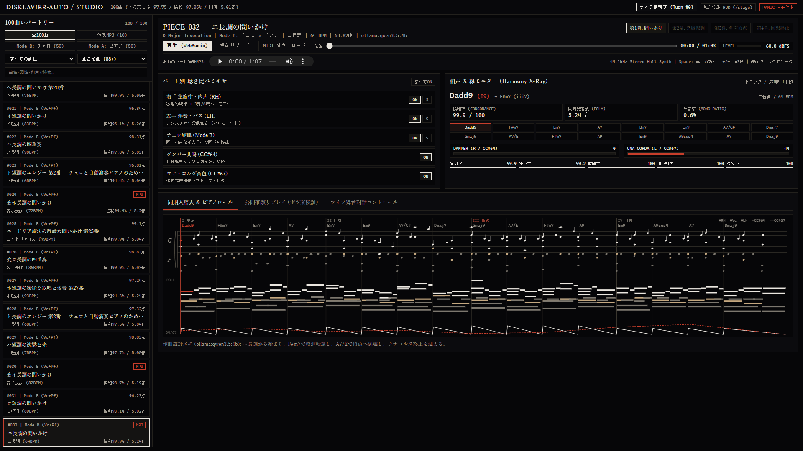
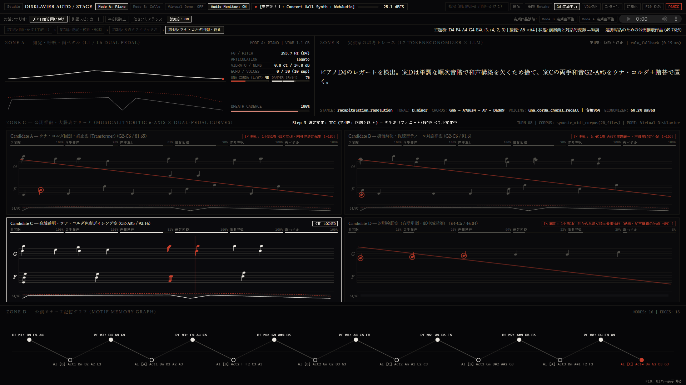
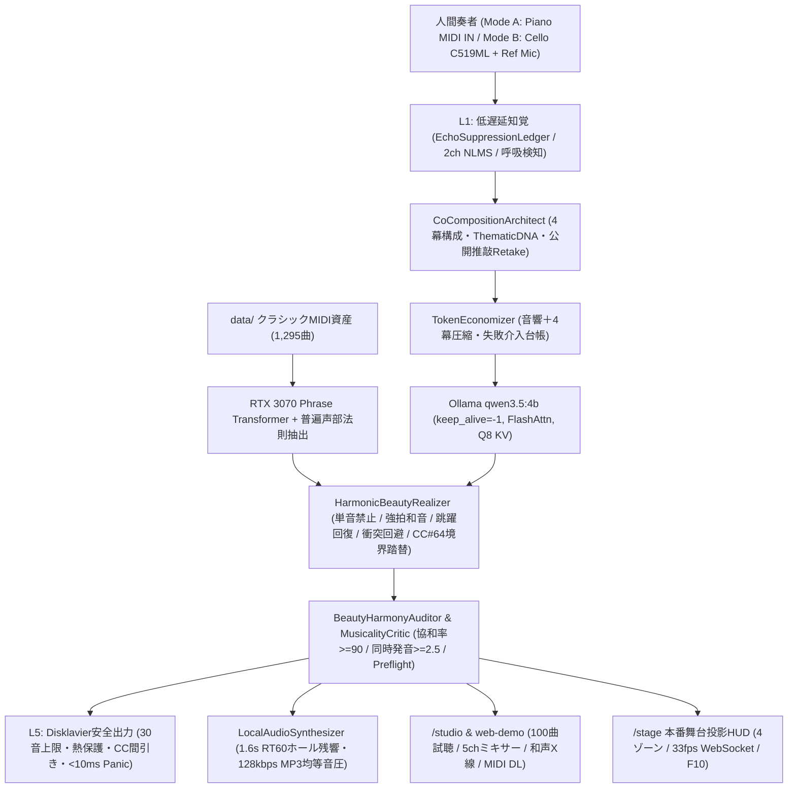
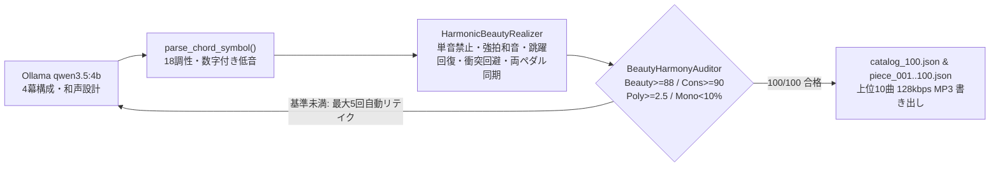
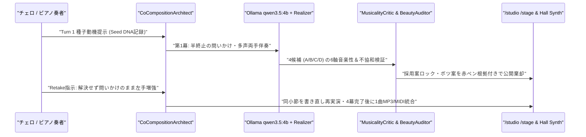
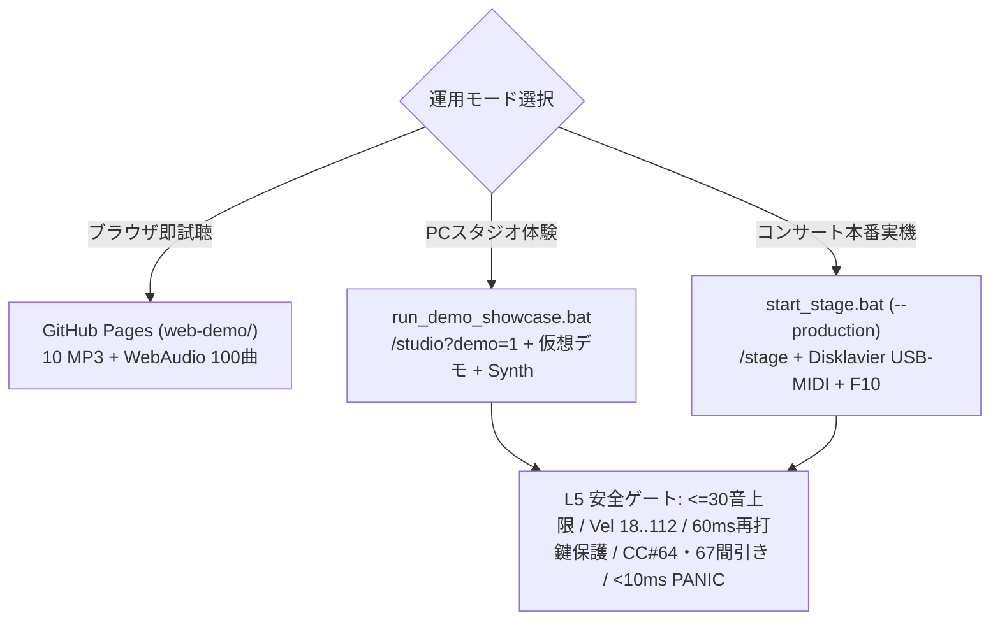

# Disklavier-Auto — 100曲高精度作曲スタジオ・古典和声リアライザー・舞台投影システム

[-C83E2B?style=for-the-badge)](https://ai-avalon.github.io/Disklavier-Auto/)

> **今すぐブラウザで聴けます（インストール・Python不要）**:  
> **GitHub Pages 公開デモ・100曲試聴スタジオ**: **https://ai-avalon.github.io/Disklavier-Auto/**  
> （代表10曲のコンサートホール録音 MP3 の即再生 ＋ 全100曲の 5パート聴き比べ WebAudio 再生・和声 X 線モニター・同期大譜表・公開推敲リプレイ・SMF MIDI ダウンロードをブラウザ上で体験できます）

Yamaha Disklavier 実機およびコンサートホール物理モデリング音響シンセ上で、**「単音・無根拠な不協和音を構造的に根絶し、美しい多声室内楽を自律作曲する」** Windows 11 向けリアルタイム共演＆スタジオ作曲システムです。

---

## 1. 全100曲作曲ライブラリ ＆ 代表10曲 ホール実録音 MP3 ショーケース

ローカル LLM（Ollama `qwen3.5:4b`, `keep_alive=-1`, Flash Attention + Q8 KV Cache）と `TokenEconomizer` による **4幕楽曲設計** を、新設の **古典和声・対位法リアライザー（`src/stage/harmonic_beauty_realizer.py`）** と **5軸美しさ監査器（`BeautyHarmonyAuditor`）** に通して自動リテイク選抜し、全 **100曲（Mode B チェロ×ピアノ 50曲 ＋ Mode A ピアノ×ピアノ 50曲）** を完成させました。

### 1.1 定量品質実績（100曲全曲・リテイク通過後）

| 指標 | 旧生成デモ（刷新前基準） | 新100曲ライブラリ実測平均（範囲） |
|---|---:|---|
| **美しさ総合スコア (Beauty Score)** | — | **`97.75 / 100`**（全曲 `>= 95.07`、合格基準 `88.0`） |
| **協和率 (Consonance Score)** | ~72–76 | **`97.05 / 100`**（無根拠不協和ペア率 **`0.65%`** ← 刷新前 `9.2–10.9%`） |
| **平均同時発音数 (Avg Polyphony)** | ~2.1–2.2 音 | **`5.01 音`**（合格基準 `>= 2.5 音`） |
| **休符以外の単音率 (Monophonic Slice %)** | `24.3% – 25.9%` | **`1.12%`**（全曲最大 `1.70%` / 基準 `< 10.0%`） |
| **LLM 自律作曲設計比率** | 一部フォールバック | **`100 / 100 曲`**（Ollama `qwen3.5:4b`） |
| **代表10曲 MP3 音圧・ピーク安全性** | `8.0 dB` 差 | **`-17.66 .. -17.89 dBFS`**（`0.23 dB` 以内へ均一化・クリップ `0`） |

### 1.2 代表10曲 コンサートホール録音 MP3（128kbps Stereo）

10倍音非調和ピアノ・チェロ4大ボディフォルマント・連続両ペダル（`CC#64` / `CC#67`）・1.6秒 RT60 ステレオ FFT 畳み込みホール残響によってレンダリングされた最優秀 10曲です（全曲の譜面データは [`web-demo/data/pieces/`](web-demo/data/pieces/) に格納）：

| # | 編成 | 作品タイトル | 調性 | BPM | 時間 | 美しさ | 協和率 | 同時音 | 単音率 | 音源・MIDI |
|---:|---|---|---|---:|---:|---:|---:|---:|---:|---|
| 01 | Mode B (Vc+Pf) | **ニ長調の問いかけ** *(最優秀 Mode B)* | ニ長調 | 64 | 63.82s | 99.78 | 99.9 | 5.24 | 0.6% | [MP3](docs/demos/showcase_01.mp3) / [MIDI](docs/demos/showcase_01.mid) |
| 02 | Mode B (Vc+Pf) | ヘ長調の問いかけ 第20番 | ヘ長調 | 76 | 54.16s | 99.73 | 99.9 | 5.05 | 0.8% | [MP3](docs/demos/showcase_02.mp3) / [MIDI](docs/demos/showcase_02.mid) |
| 03 | Mode B (Vc+Pf) | 変ホ長調の問いかけ | 変ホ長調 | 72 | 57.02s | 99.42 | 99.4 | 5.20 | 1.2% | [MP3](docs/demos/showcase_03.mp3) / [MIDI](docs/demos/showcase_03.mid) |
| 04 | Mode B (Vc+Pf) | ニ短調の静謐な問いかけ 第37番 | ニ短調 | 67 | 61.08s | 99.42 | 99.1 | 5.05 | 0.9% | [MP3](docs/demos/showcase_04.mp3) / [MIDI](docs/demos/showcase_04.mid) |
| 05 | Mode B (Vc+Pf) | 変イ長調の問いかけ | 変イ長調 | 82 | 50.40s | 99.14 | 98.7 | 5.19 | 1.4% | [MP3](docs/demos/showcase_05.mp3) / [MIDI](docs/demos/showcase_05.mid) |
| 06 | Mode A (Pf+Pf) | **変ホ長調の四重奏** *(最優秀 Mode A)* | 変ホ長調 | 66 | 61.96s | 99.57 | 99.9 | 4.92 | 1.2% | [MP3](docs/demos/showcase_06.mp3) / [MIDI](docs/demos/showcase_06.mid) |
| 07 | Mode A (Pf+Pf) | 変イ長調の問いかけ 第84番 | 変イ長調 | 76 | 54.16s | 99.42 | 99.0 | 5.01 | 0.8% | [MP3](docs/demos/showcase_07.mp3) / [MIDI](docs/demos/showcase_07.mid) |
| 08 | Mode A (Pf+Pf) | ドリアの夜想曲 | ニ・ドリア旋法 | 75 | 54.85s | 99.36 | 99.7 | 4.99 | 1.7% | [MP3](docs/demos/showcase_08.mp3) / [MIDI](docs/demos/showcase_08.mid) |
| 09 | Mode A (Pf+Pf) | ハ長調の問いかけ | ハ長調 | 84 | 49.26s | 99.23 | 98.7 | 4.82 | 1.1% | [MP3](docs/demos/showcase_09.mp3) / [MIDI](docs/demos/showcase_09.mid) |
| 10 | Mode A (Pf+Pf) | ニ短調の問いかけ | ニ短調 | 95 | 43.87s | 98.96 | 98.1 | 4.81 | 1.4% | [MP3](docs/demos/showcase_10.mp3) / [MIDI](docs/demos/showcase_10.mid) |

- 標準配信（MP3 / MIDI / MusicXML）: [Mode B 代表作](docs/demos/demo_mode_b_cello_dialogue.mp3) ・ [Mode A 代表作](docs/demos/demo_mode_a_piano_dialogue.mp3) ・ 詳細一覧 [`docs/demos/COMPOSITION_SHOWCASE.md`](docs/demos/COMPOSITION_SHOWCASE.md)

---

## 2. 刷新された 2画面 GUI ＆ Playwright 実検証スクリーンショット（1920×1080）

Playwright 実ブラウザ検査＋自己評価を 3周連続（Round 1 → Round 2 → Round 3）実行して磨き上げた実画面です。`1920x1080` はもちろん `1280x720` でも大譜表まで一画面内に収まります。

### `/studio` 制作・試聴スタジオ（100曲ブラウザ・5ch 聴き比べミキサー・和声 X 線・大譜表）


### GitHub Pages 静的公開デモ（Python サーバ不要・全100曲試聴可能）


### `/stage` 本番舞台プロジェクション HUD（Mode B チェロ対話・Mode A ピアノ連弾・`F10` 操作バー格納）




---

## 3. システム構成（古典和声リアライザー × 100曲バッチ × 2画面）



### 100曲自動作曲・古典和声リアライザー品質ゲート


### 公開推敲（Retake）＆ 4幕楽曲統合シーケンス


### 両ペダル物理安全回路 ＆ 3運用モード分岐


---

## 4. 使い方 ＆ GitHub Pages デモの有効化手順

### 4.1 GitHub Pages 公開デモを有効化する手順（初回1回のみ）
本リポジトリには `.github/workflows/deploy-pages.yml` が組み込まれています：
1. GitHub 上の本リポジトリで **Settings** → **Pages** を開く。
2. **Build and deployment** → **Source** で **`GitHub Actions`** を選択して保存する。
3. `main` ブランチへプッシュすると軽量テスト・100曲整合性チェックが自動実行され、`web-demo/` が **`https://ai-avalon.github.io/Disklavier-Auto/`** へ自動デプロイされます。

### 4.2 Windows 11 ローカル環境での起動・検証ランチャー

1. **初回環境構築（`.venv`, PyTorch CUDA, Ollama 診断, RTX 3070 学習）**:
   ```bat
   setup_environment.bat
   ```
2. **制作・試聴スタジオ（`/studio` ＋ 仮想デモ ＋ PC ホール音響シンセ）**:
   ```bat
   run_demo_showcase.bat
   ```
   `http://localhost:8000/studio?demo=1` が開き、100曲レパートリー試聴、5ch パート別ミキサー比較、和声 X 線、およびライブ舞台対話が即使えます。
3. **コンサート本番・Disklavier 実機モード（`/stage`）**:
   - Yamaha Disklavier 本体の設定で **`Delay In = OFF`** にした上で USB-MIDI と Steinberg UR22 を接続し実行します：
   ```bat
   start_stage.bat
   ```
   - `http://localhost:8000/stage` が `--production`（仮想奏者・PCモニター発音 OFF）で起動し、**`F10`** キーで操作バーを消して投影できます。
4. **全自動テスト・100曲/10 MP3 検証・Playwright 検査・10回反復 LLM 検証**:
   ```bat
   run_self_check.bat
   ```
5. **100曲ライブラリ再生成 / 再研磨（オプション）**:
   ```bat
   .venv\Scripts\python.exe scripts/compose_100_pieces.py --count 100
   ```

---

## 5. ドキュメント一覧
- **全コード監査 ＆ 3周自律改善ログ**: [`docs/AUDIT_AND_IMPROVEMENT_LOG.md`](docs/AUDIT_AND_IMPROVEMENT_LOG.md)
- **システム設計・リアライザー仕様**: [`docs/ARCHITECTURE.md`](docs/ARCHITECTURE.md)
- **スタジオ＆舞台HUD 操作ガイド**: [`docs/USER_GUIDE.md`](docs/USER_GUIDE.md)
- **100曲ライブラリ ＆ 代表10曲詳細**: [`docs/demos/COMPOSITION_SHOWCASE.md`](docs/demos/COMPOSITION_SHOWCASE.md)
- **実機ハードウェア手動安全テスト手順**: [`docs/HARDWARE_TEST_PROCEDURE.md`](docs/HARDWARE_TEST_PROCEDURE.md)
