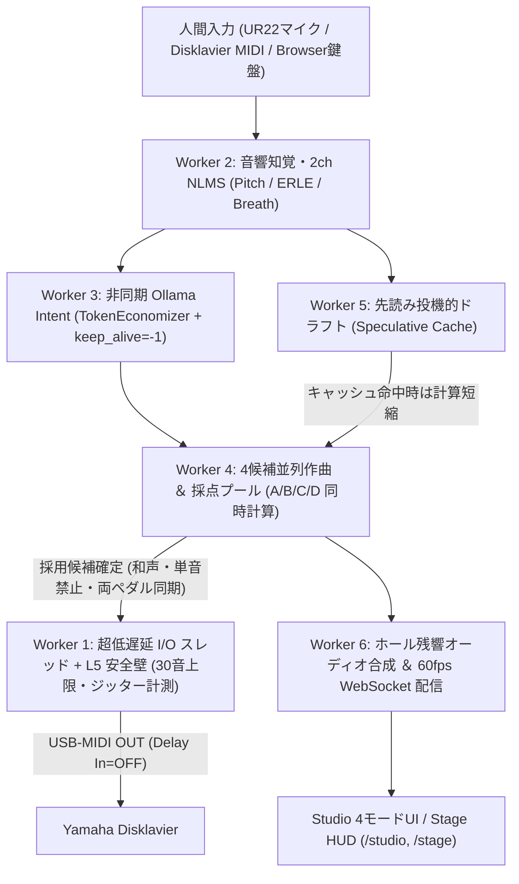
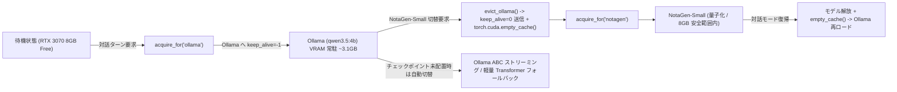
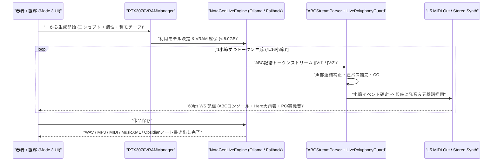
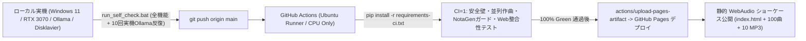
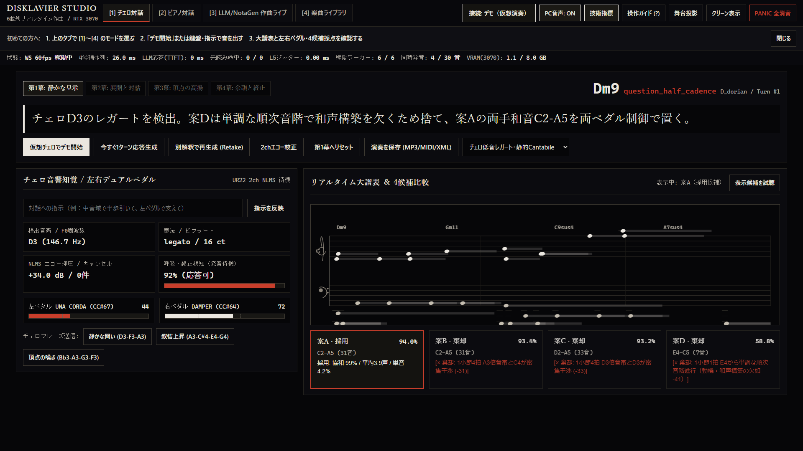
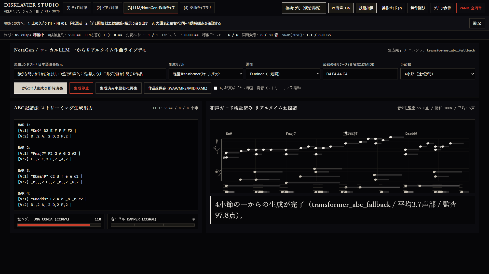
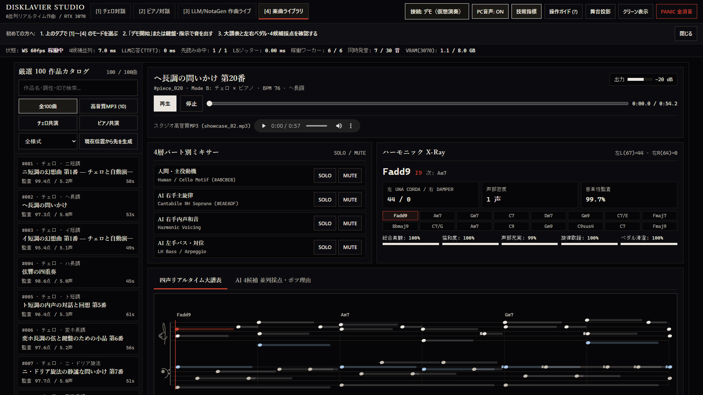

# DISKLAVIER STUDIO / Disklavier-Auto

**リアルタイム 6 並列対話作曲 ＆ NotaGen / ローカル LLM 一から演奏生成システム（Yamaha Disklavier 実機 + WebAudio 公開ショーケース）**

DISKLAVIER STUDIO は、人間（チェロまたはピアノ）の生演奏に呼応して即座に作曲・和声検証・左右デュアルペダル制御を行うリアルタイム演奏・作曲スタジオです。事前録音データの再生に留まらず、**今この瞬間に弾かれた音へのリアルタイム並列応答**と、**ローカル LLM / NotaGen による一からのストリーミング作曲・即座発音**を実現しています。

- 公開 WebAudio ショーケース (GitHub Pages): [https://ai-avalon.github.io/Disklavier-Auto/](https://ai-avalon.github.io/Disklavier-Auto/)
- 詳細操作マニュアル: [docs/USER_GUIDE.md](docs/USER_GUIDE.md)
- システム＆CI監査レポート: [docs/CURRENT_STATUS_AUDIT.md](docs/CURRENT_STATUS_AUDIT.md)

---

## 1. 4つの明確な演奏・作曲モード

1. **`[1] チェロ対話`（Mode B: Cello ⇄ Disklavier）**
   - AKG C519ML + UR22（実機）または仮想チェロの音響入力を 2ch NLMS エコー除去とピッチ（F0）解析で捉え、人間の呼吸・終止の瞬間に 4 候補を並列作曲し、`MusicalityCritic` で和声・ペダル検証を通過した案のみを演奏します。
2. **`[2] ピアノ対話`（Mode A: Human Piano ⇄ AI Piano）**
   - 実機 Disklavier の生鍵盤、Web 画面鍵盤クリック、または PC キーボード（`A W S E D F T G Y H U J K`）の演奏を、自己打鍵分離フィルタで区別しながら水色（人間）／金色（AI 先読み）／朱色（L5 確定打鍵）でリアルタイム可視化して掛け合います。左ペダル（`CC#67`）合図にも対応しています。
3. **`[3] LLM/NotaGen 作曲ライブ`（一からリアルタイム生成）**
   - 日本語コンセプト・調性・数音の種モチーフから、ローカル Ollama LLM または NotaGen-Small が ABC 記譜トークンを1小節ずつ逐次生成し、リアルタイム和声・声部連結ガードを通して即座に発音・楽譜描画します。
4. **`[4] 楽曲ライブラリ`（厳選 100 作品 ＋ 高音質 MP3 10 曲）**
   - 音楽性監査 95 点以上・平均 5.0 声部の厳選 100 作品とスタジオ MP3 を、4 層パート別ミキサー（`SOLO` / `MUTE`）、ハーモニック X-Ray、および大譜表タイムマシンシークで詳細に分析・試聴できます。再生中の位置からそのまま `[3]` へ引き継いで先の展開を生成させることもできます。

---

## 2. クイックスタート（3分で体験）

### デモモード（PC とスピーカーのみで即時体験）
```bat
run_demo_showcase.bat
```
- 空きポートを自動解決して `data/telemetry/active_stage_url.txt` に URL を書き出し、自動で `/studio?demo=1` を開きます。
- 緊急全消音は **`Esc`** キーまたは右上の **PANIC 全消音**、舞台投影用のクリーン表示切替は **`F10`** キーです。

### 本番実機セットアップ（Yamaha Disklavier + UR22）
- **重要設定**: Disklavier 本体の設定メニューで **`Delay In = OFF`** に設定してください（外部入力バッファによる約 500ms 遅延を無効化するため必須です）。
- **起動ランチャー**: `start_stage.bat`（`/stage` 舞台投影ビュー＋実機ハードウェアモード）を実行し、画面上の **`2chエコー較正`** を1回クリックしてから演奏を開始してください。
- **物理ペダル配置**: 画面左が **左ペダル `UNA CORDA (CC#67)`**、画面右が **右ペダル `DAMPER (CC#64)`** で統一されています。

---

## 3. システム・並列パイプライン設計（Mermaid 図解）

### 3.1 6並列リアルタイム作曲・低遅延パイプライン（Worker 1〜6）



### 3.2 RTX 3070 (VRAM 8GB) 動的 VRAM マネージャ状態遷移



### 3.3 NotaGen / ローカル LLM 一からライブ作曲シーケンス



### 3.4 CI 環境分離と GitHub Pages 自動デプロイ構成



---

## 4. 画面ギャラリー（Playwright 実ブラウザ検証済み）

| Studio Mode [1] チェロ対話 | Studio Mode [2] ピアノ対話 |
| :---: | :---: |
|  |  |

| Studio Mode [3] NotaGen / LLM ライブ作曲 | Studio Mode [4] 100曲ライブラリ |
| :---: | :---: |
|  |  |

| Stage HUD (`/stage`) | F10 舞台投影クリーン表示 | WebAudio 公開デモ |
| :---: | :---: | :---: |
|  |  |  |

---

## 5. テスト ＆ 自己検証コマンド

- **CI 準拠ローカル模擬テスト（GPU / Ollama / オーディオデバイス無し環境を厳格再現）**:
  ```bat
  python scripts/simulate_ci_local.py
  ```
- **完全自動検証 ＆ 10回実機反復テスト（`Ollama` + `MusicalityCritic` + `Playwright` 視覚監査）**:
  ```bat
  run_self_check.bat
  ```
- **初回・環境構築**:
  ```bat
  setup_environment.bat
  ```
