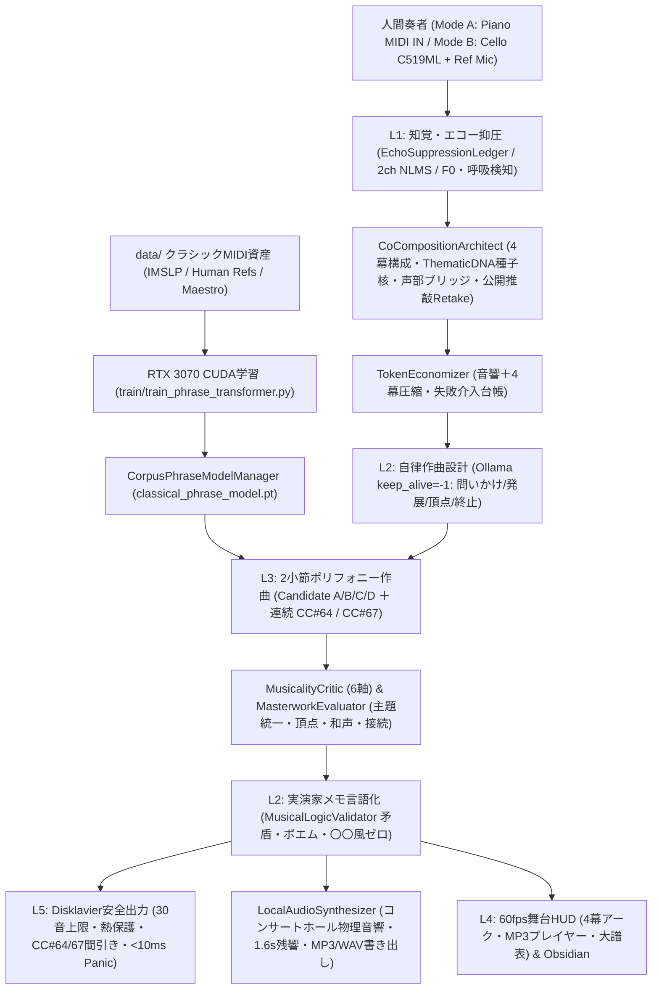
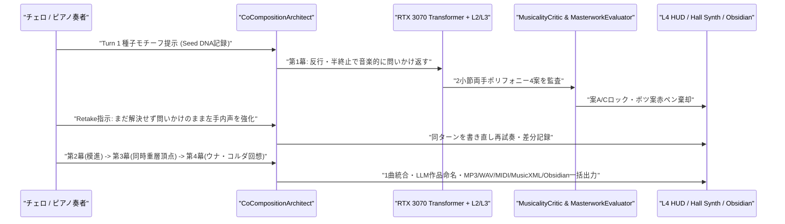
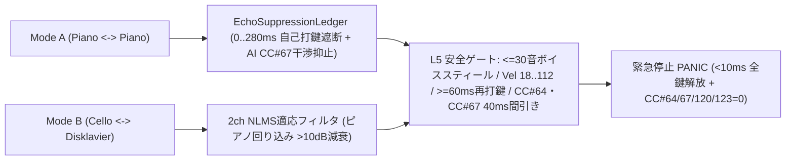
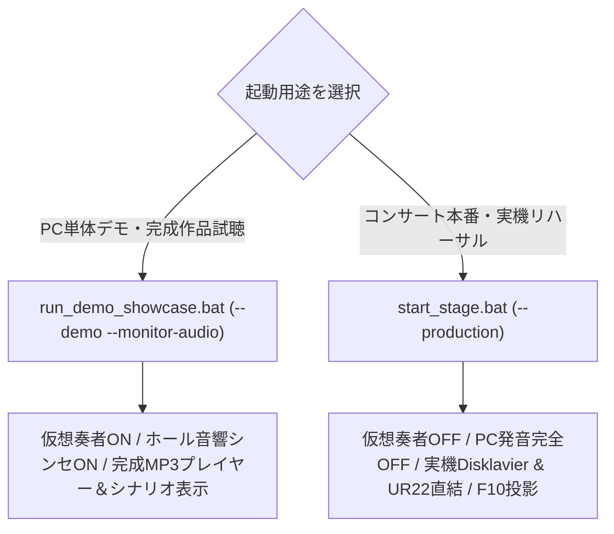

# Disklavier-Auto — 4幕共同作曲エンジン・RTX 3070コーパス学習・ホール音響舞台システム

> **「問いかけと応答で1つの楽曲を共同作曲する」4幕構成アーキテクチャ × RTX 3070 MIDI学習 × コンサートホール物理モデリング音響 × 舞台公開推敲HUD**  
> Yamaha Disklavier 実機とチェロ／ピアノ奏者が対話し、**L1知覚 → `CoCompositionArchitect`（4幕大局構成・種子核・声部接続）→ RTX 3070 `ClassicalPhraseTransformerNet` 推論 → `TokenEconomizer` × Ollama → `MasterworkEvaluator` / `MusicalityCritic` 監査 → L5安全駆動＆コンサートホールステレオ音響（`.mp3`/`.wav`/`.mid`/`.musicxml`）→ L4 60fps舞台HUD＆Obsidianアーカイブ** までを一貫実行する Windows 11 リアルタイム共演作曲システムです。

---

## 1. 完成デモ音源（`.mp3` / `.wav` / `.mid` / `.musicxml`）＆ 楽曲アナリーゼ

ローカル Ollama（`qwen3.5:4b`）、RTX 3070 学習済みフレーズモデル（`data/models/classical_phrase_model.pt`）、4幕構成エンジン、およびコンサートホール物理モデリング音響シンセを実際に稼働させ、公開リハーサル（小節の書き直し）を経て1曲として完成させた音源と楽譜を収録しています（MIDIソフト不要でそのまま試聴できます）。

### 作品1（Mode B：チェロ × Disklavier 対話作品）
- **作品名**: *D ドリアン変奏曲：G3 への四度昇進* (*Variations on D Dorian: The Fourth Ascent to G3*)
- **構成**: 4幕8ターン ＋ 公開推敲書き直し（Turn 2）＋ ウナ・コルダ回想コーダ（総演奏時間 **56.18 秒** / 44.1kHz Stereo / `RMS=0.11515` / `Clipping=0`）
- **試聴・楽譜**:
  - [MP3 完成音源 (`demo_mode_b_cello_dialogue.mp3`)](docs/demos/demo_mode_b_cello_dialogue.mp3)
  - [WAV マスター音源 (`demo_mode_b_cello_dialogue.wav`)](docs/demos/demo_mode_b_cello_dialogue.wav)
  - [標準MIDI (`demo_mode_b_cello_dialogue.mid`)](docs/demos/demo_mode_b_cello_dialogue.mid)
  - [MusicXML 大譜表 (`demo_mode_b_cello_dialogue.musicxml`)](docs/demos/demo_mode_b_cello_dialogue.musicxml)

### 作品2（Mode A：人間ピアノ × Disklavier 連弾対話作品）
- **作品名**: *前奏曲と対話的変奏 ニ短調 — 連弾対話のための公開推敲作品* (*Prelude and Dialogic Variations in D minor for Two Pianists*)
- **構成**: 4幕8ターン ＋ 公開推敲書き直し（Turn 2）＋ 終止コーダ（総演奏時間 **55.59 秒** / 44.1kHz Stereo / `RMS=0.08653` / `Clipping=0`）
- **試聴・楽譜**:
  - [MP3 完成音源 (`demo_mode_a_piano_dialogue.mp3`)](docs/demos/demo_mode_a_piano_dialogue.mp3)
  - [WAV マスター音源 (`demo_mode_a_piano_dialogue.wav`)](docs/demos/demo_mode_a_piano_dialogue.wav)
  - [標準MIDI (`demo_mode_a_piano_dialogue.mid`)](docs/demos/demo_mode_a_piano_dialogue.mid)
  - [MusicXML 大譜表 (`demo_mode_a_piano_dialogue.musicxml`)](docs/demos/demo_mode_a_piano_dialogue.musicxml)

- **全ターン推敲アナリーゼ・ボツ案棄却理由・書き直し記録**: [`docs/demos/COMPOSITION_SHOWCASE.md`](docs/demos/COMPOSITION_SHOWCASE.md)

---

## 2. 舞台HUD 実画面スクリーンショット（1920x1080）

### Mode B: チェロ × Disklavier（第3幕クライマックス・公開推敲・連続両ペダル波形）


### Mode A: ピアノ × Disklavier（第4幕ウナ・コルダ回想終止・16ノード記憶グラフ・完成曲統合）


---

## 3. 本システムの抜本再構築ポイント

1. **1つの楽曲を育てる「4幕大局構成エンジン (`src/stage/co_composition_architect.py`)」**:
   - 毎ターン無関係な断片を出す設計を廃止し、**第1幕（種子動機の提示と半終止での音楽的問いかけ）→ 第2幕（ゼクエンツ模進・近親調転調・声部ブリッジ接続）→ 第3幕（低音バス保続音＋多声統合のクライマックスと単一頂点）→ 第4幕（ウナ・コルダによる冒頭動機の回想と完全終止）** の楽曲構成アークを形成します。
   - **公開リハーサル（Retake）** で人間のダメ出しに応じて直前フレーズをその場で書き直し、最後に **`[作品を完成させ通し演奏]`** で全ターンを1曲の完結作品へ統合・自動命名して MP3/WAV/MIDI/MusicXML/Obsidian へ一括出力します。
2. **RTX 3070（CUDA）クラシックMIDIコーパス実学習（`train/train_phrase_transformer.py` & `src/stage/corpus_phrase_model.py`）**:
   - `data/imslp_midi/`, `data/human_references/`, `data/maestro-v3.0.0/` から `symusic` で抽出した1,975フレーズ窓（174曲解析）を RTX 3070 CUDA 上で学習し、`data/models/classical_phrase_model.pt` を構築しました。
   - **跳躍後の順次逆行回復（Post-Leap Gap-Fill Law）**、**息づく左手伴奏イディオム（根音→5度→10度開離アルペジオ、バス保続音＋内声対旋律、裏拍シンコペーション和音、ウナ・コルダコラール）**、**4-3/9-8/7-6 掛留解決**、**アゴーギク・ルバート曲線** をリアルタイム推論します。
3. **`TokenEconomizer` × Ollama × `MasterworkEvaluator` + `MusicalityCritic`**:
   - [`src/stage/token_economizer.py`](src/stage/token_economizer.py) が知覚特徴と4幕構成・声部ブリッジ・失敗介入台帳を圧縮（約 57〜61% 削減）して RTX 3070 Ollama へ渡します。
   - [`src/stage/musicality_critic.py`](src/stage/musicality_critic.py) が6軸監査に加え **Masterwork 4基準（主題統一性・旋律頂点設計・機能和声引力・フレーズ間声部接続）** で審査し、単調な音階・単声・短2度濁りを排除します。
4. **コンサートホール物理モデリング音響シンセ（`src/stage/local_audio_synth.py`）**:
   - 10倍音非調和ピアノモデル（3本弦微小デチューン・二段階響板減衰・ハンマーフェルト打撃）、チェロ4大ボディフォルマント（200/420/950/2150Hz）＋松脂擦弦・漸進ビブラート、連続ダンパー（`CC#64`）＆ウナ・コルダ（`CC#67`）物理音響、さらに **室内楽ホール（1.6s RT60）ステレオFFT畳み込み残響** を搭載し、44.1kHz Stereo WAV/MP3 を直接生成します。
5. **Obsidian 完全連携 ＆ 純粋ASCII `.bat` / `/favicon.ico` 200 OK**:
   - 各ターンの推敲記録（`obsidian_vault/05_Stage_Session_Logs/`）に加え、完成作品のタイトル・4幕推移・書き直し履歴・MP3/WAV/MIDI/MusicXMLリンクを `obsidian_vault/02_Hall_of_Fame_Performances/` へ自動保存します。

---

## 4. システムアーキテクチャ＆安全回路（Mermaid図解）

### 4幕共同作曲 ＆ 5レイヤー全体構成


### 公開推敲（Retake）＆ 完成作品統合フロー


### 両ペダル連続制御 ＆ 物理安全回路


### デモモードと本番実機モードの運用分岐


---

## 5. 使い方（クイックスタート）

1. **初回セットアップ（PyTorch CUDA・RTX 3070 コーパス学習含む）**:
   ```bat
   setup_environment.bat
   ```
   `.venv` 構築、必須パッケージ（`torch` CUDA 12.4、`lameenc` 等）導入、`src.stage.config_scanner` による環境診断、および `train/train_phrase_transformer.py` によるモデル重み構築を一括実行します。
2. **デモ・試聴モード（PCスピーカーで体験）**:
   ```bat
   run_demo_showcase.bat
   ```
   `http://localhost:8000/?demo=1` が開き、4幕アークのリアルタイム対話、`推敲書き直し (Retake)`、`作品を完成させ通し演奏`、および完成デモMP3試聴が利用できます。
3. **本番・リハーサル実機モード**:
   - Yamaha Disklavier 側メニューで **`Delay In = OFF`** に設定し、USB-MIDI と Steinberg UR22（Ch1: AKG C519ML / Ch2: ピアノ参照マイク）を接続した状態で起動します：
   ```bat
   start_stage.bat
   ```
   - 開演前に上部の `VDL/NLMS校正` と `記憶初期化` を押し、`F10` キーで操作バーを格納して客席へ投影します。
4. **全自動テスト ＆ 10回反復検証**:
   ```bat
   run_self_check.bat
   ```
   `tests/test_stage_system.py`、`pytest tests/`、`validate_system_integrity.py`、および実Ollama・4幕構成・完成音源検証・安全ゲート10回連続ループ（`scripts/run_10x_iterative_refinement.py`）を一括実行します。

---

## 6. 詳細ドキュメント
- アーキテクチャ設計詳細: [`docs/ARCHITECTURE.md`](docs/ARCHITECTURE.md)
- 操作・運用・トラブルシューティング: [`docs/USER_GUIDE.md`](docs/USER_GUIDE.md)
- 実機ハードウェア手動安全テスト手順: [`docs/HARDWARE_TEST_PROCEDURE.md`](docs/HARDWARE_TEST_PROCEDURE.md)
- 4幕共同作曲マスターワーク解説: [`docs/demos/COMPOSITION_SHOWCASE.md`](docs/demos/COMPOSITION_SHOWCASE.md)
