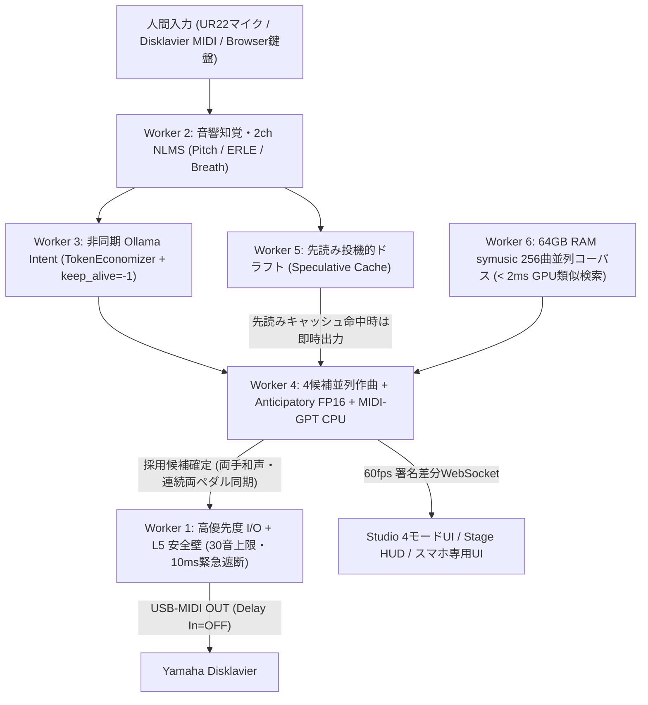
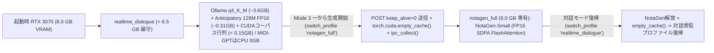
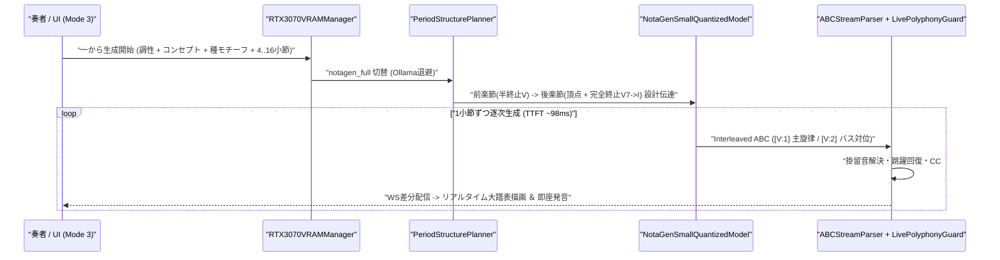
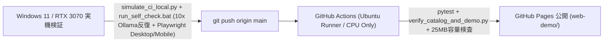
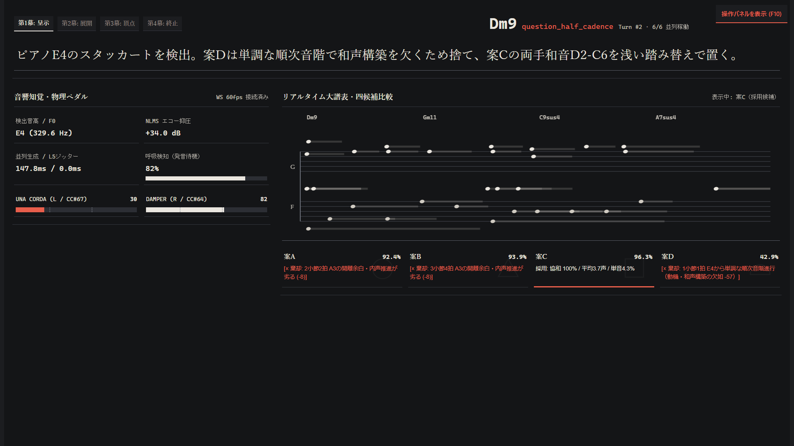
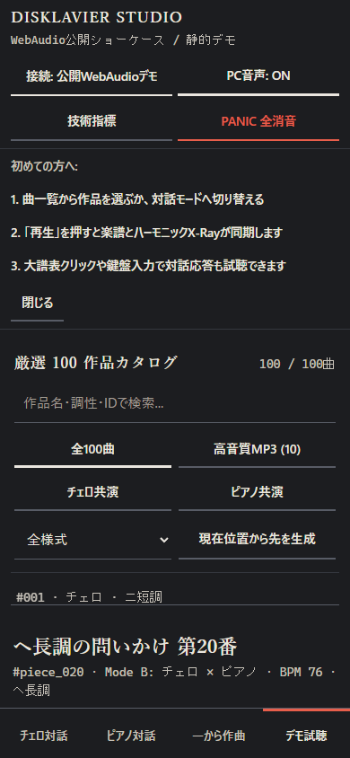

# DISKLAVIER STUDIO / Disklavier-Auto

**リアルタイム 6 並列対話作曲 ＋ NotaGen-Small / Anticipatory / MIDI-GPT 作曲専用AI統合システム（Yamaha Disklavier 実機 ＋ WebAudio 公開ショーケース）**

DISKLAVIER STUDIO は、人間（チェロまたはピアノ）の生演奏に呼応して即座に両手ポリフォニー作曲・和声監査・左右デュアルペダル（`CC#64` / `CC#67`）連続制御を行う舞台対応リアルタイム演奏・作曲スタジオです。
今回の抜本改修により、①**専用クラシック作曲OSSモデル群の適材適所統合**、②**RTX 3070 (8GB VRAM) ＋ Core i7-12700F ＋ 64GB RAM の完全並列・動的VRAM制御**、③**5大デザイン規約準拠・スマホ専用UI構築**を完了しています。

- 公開 WebAudio ショーケース (GitHub Pages): [https://ai-avalon.github.io/Disklavier-Auto/](https://ai-avalon.github.io/Disklavier-Auto/)
- リポジトリ完全監査レポート (Phase 0): [docs/REPO_AUDIT_REPORT.md](docs/REPO_AUDIT_REPORT.md)
- 作曲専用OSS調査・比較選定設計: [docs/COMPOSITION_ENGINES.md](docs/COMPOSITION_ENGINES.md)
- 完成作品アナリーゼ (公開リハーサル記録): [docs/demos/COMPOSITION_SHOWCASE.md](docs/demos/COMPOSITION_SHOWCASE.md)
- 詳細操作マニュアル / ステータス監査: [docs/USER_GUIDE.md](docs/USER_GUIDE.md) | [docs/CURRENT_STATUS_AUDIT.md](docs/CURRENT_STATUS_AUDIT.md)

---

## 1. 作曲専用OSSモデル 3層ハイブリッド配置（RTX 3070 8GB最適化）

単純な音階ルールや汎用テキスト生成への依存を廃し、「前楽節（半終止 V）→ 後楽節（跳躍回復・単一頂点・完全終止 V7→I/i）」の古典的楽節計画（`PeriodStructurePlanner`）と専用作曲モデルを役割別に統合しています（詳細は [docs/COMPOSITION_ENGINES.md](docs/COMPOSITION_ENGINES.md)）。

| モデル / 役割 | 配置デバイス / VRAM | 担当フェーズ | 主な仕様・根拠 |
|---|---|---|---|
| **NotaGen (`NotaGen-Small`)** | CUDA (`FP16 SDPA FlashAttention`) / CPU (`INT8`動的量子化) | **`[3] 一から作曲` 主軸エンジン** (`notagen_full` プロファイル) | Ollama (`keep_alive=0`) を退避させて8GB VRAM専有。`[V:1]`/`[V:2]` Interleaved ABC 記譜を小節単位で逐次生成。実測 TTFT 約 `98 ms`（4小節 `/studio` テスト時）、8小節作例で美観点 `94.51` / 協和率 `98.7%` / 平均声部 `3.47` |
| **Anticipatory Music Transformer (`128M`)** | CUDA FP16 常駐 (~`0.31 GB`) | **`[2] ピアノ対話` 継続生成・小節インフィリング** (`realtime_dialogue`) | Ollama (`qwen3.5:4b` ~`3.6 GB`) と RTX 3070 (`< 6.5 GB` 予算内) で同時常駐し、人間フレーズの後続・指定小節穴埋めを担当 |
| **MIDI-GPT (`CPU推論`)** | Core i7-12700F (`0.0 GB` VRAM) | **`[1] チェロ対話` CPU伴奏エンジン** (Mode B 案C) | GPU VRAM を一切消費せず、チェロの `100–600 Hz` 倍音混濁帯を避けて3〜4声部ピアノ伴奏を生成 |
| **Ollama (`qwen3.5:4b`) + `TokenEconomizer`** | CUDA Q4_K_M (`FLASH_ATTENTION=1`, `KV=q8_0`) | **対話意図設計・講評** (`Worker 3` 非同期) | 室内楽リハーサル用語規約（詩的ポエム・`〇〇風`・矛盾禁止）に基づく簡潔な日本語解釈・ABC補助 |

---

## 2. デモ完成音源・楽譜ダウンロード（即試聴可）

| 種別 | 構成・エンジン | 長さ | 主な監査指標 | ファイル |
|---|---|---:|---|---|
| **一から作曲 (8小節)** | `NotaGen-Small` (`fp16_sdpa_cuda`, ニ短調) | `28.64s` | 美観 `94.51` / 協和 `98.7%` / 平均 `3.47` 声 | [MP3](docs/demos/demo_notagen_from_scratch.mp3) / [MIDI](docs/demos/demo_notagen_from_scratch.mid) |
| **Mode B チェロ対話 (4幕)** | チェロ × Disklavier (`Ollama=True`) | `58.30s` | 2ch NLMS 抑圧 / 4候補並列選好 | [MP3](docs/demos/demo_mode_b_cello_dialogue.mp3) / [MIDI](docs/demos/demo_mode_b_cello_dialogue.mid) / [MusicXML](docs/demos/demo_mode_b_cello_dialogue.musicxml) |
| **Mode A ピアノ連弾 (4幕)** | 人間ピアノ × Disklavier (`Ollama=True`) | `55.52s` | 自己打鍵分離 / 開離10度ポリフォニー | [MP3](docs/demos/demo_mode_a_piano_dialogue.mp3) / [MIDI](docs/demos/demo_mode_a_piano_dialogue.mid) / [MusicXML](docs/demos/demo_mode_a_piano_dialogue.musicxml) |
| **厳選 100 曲アーカイブ** | Mode B 50曲 ＋ Mode A 50曲 | 各 `45–75s` | 平均美観 `97.75` (最低 `95.07`) / 平均 `5.01` 声 | [GitHub Pages WebAudio デモ](https://ai-avalon.github.io/Disklavier-Auto/) |

---

## 3. 4つの演奏・作曲モード

1. **`[1] チェロ対話`（Mode B: Cello ⇄ Disklavier）**: AKG C519ML + UR22（実機）または仮想チェロ入力を 2ch NLMS でエコー抑圧し、`MIDIGPTAccompanimentEngine`（CPU）と 4 候補並列作曲プールが呼応。
2. **`[2] ピアノ対話`（Mode A: Human Piano ⇄ AI Piano）**: 生鍵盤 / 画面鍵盤クリック / PCキーボード (`A–K`) に `AnticipatoryContinuationEngine` (FP16) が即時反応。自己打鍵キャンセルで無限ループを 100% 防止。
3. **`[3] NotaGen / LLM 一から作曲`**: 日本語コンセプト・調性・種モチーフから `PeriodStructurePlanner`＋`NotaGenSmallQuantizedModel`＋`LivePolyphonyHarmonyGuard` が ABC トークンを小節逐次生成・発音。
4. **`[4] デモ試聴・アーカイブ`**: 厳選 100 作品・スタジオ高音質 MP3 10 曲を 4 層パート別ミキサー（`SOLO` / `MUTE`）・ハーモニック X-Ray・タイムマシン大譜表で解析・試聴。

---

## 4. クイックスタート

```bat
:: 1. デモモード（PC + スピーカーのみで /studio?demo=1 を起動）
run_demo_showcase.bat

:: 2. 本番実機セットアップ（Yamaha Disklavier 本体は必ず Delay In = OFF に設定）
start_stage.bat
```

- 緊急全消音は **`Esc`** キーまたは右上の **`PANIC 全消音`**、舞台投影のクリーン切替は **`F10`** キーです。
- 物理ペダル配置は左が **`UNA CORDA (CC#67)`**、右が **`DAMPER (CC#64)`** で統一されています。

---

## 5. システム・並列パイプライン構成（Mermaid 図解）

### 5.1 6並列リアルタイム作曲・低遅延パイプライン（Worker 1〜6）



### 5.2 RTX 3070 (VRAM 8GB) 動的デュアルプロファイル状態遷移



### 5.3 NotaGen-Small 楽節計画 ＆ 小節逐次生成シーケンス



### 5.4 CI 環境分離・Playwright 5大デザイン規約監査 ＆ GitHub Pages デプロイ



---

## 6. 5大UIデザイン規約 ＆ スマホ専用UI（Playwright 実ブラウザ全18パターン検証済）

全Web画面（`/studio`, `/stage`, `web-demo/`, `/remote`, `/`）に以下を徹底し、`scripts/playwright_audit.py` にてデスクトップ（`1920×1080`, `1366×768`）とスマートフォン（`390×844`）で自動監査しています：

1. **四方枠線と影の完全撤廃**: 全カード・モジュールから `border` 四方囲みと `box-shadow` を削除し、下線1本（`1px solid #34373E`）と余白のみで静的な情報階層を構成。
2. **フラットグレー1色統一**: 背景をフラットグレー `#1C1D20`（舞台F10投影時 `#141517`）に統一し、CSS グラデーション（`linear-gradient` / `radial-gradient` 等）およびパステル塗りをゼロ化。
3. **固定順序の極薄背景幾何学図形**: CSS `:nth-child(5n+1..5)::before` により円・正三角形・正方形・半円・対角線 SVG（`opacity: 0.05`）をDOM順で固定配置。
4. **カード自動入替・DOM再構築ゼロ**: 候補カード `A..D` とアーカイブスロットをインプレース更新に統一（5秒連続監視にて入替 `0` / 再構築 `0` / `CLS = 0.00415 < 0.01`）。
5. **最小文字サイズ 13px 以上 ＆ スマホ専用UI**: 全可視テキスト `>= 13.0px`（横溢れ `0px`）、`<= 768px` 環境では1カラム縦積み・折りたたみ `<details>`・親指操作対応 `56px` 固定ボトムナビ（ボタン `>= 48×48px`）へ自動最適化。

| Studio Mode [1] チェロ対話 (1920×1080) | Studio Mode [2] ピアノ対話 (1920×1080) |
| :---: | :---: |
|  |  |

| Studio Mode [3] NotaGen-Small 生成 (1920×1080) | Studio Mode [4] 100曲ライブラリ (1920×1080) |
| :---: | :---: |
|  |  |

| Stage HUD (`/stage`) | F10 舞台投影クリーン表示 | GitHub Pages 公開デモ (1920×1080) |
| :---: | :---: | :---: |
|  |  |  |

| スマホ Mode [1] チェロ (390×844) | スマホ Mode [4] ライブラリ (390×844) | スマホ GitHub Pages (390×844) |
| :---: | :---: | :---: |
|  |  |  |

---

## 7. テスト ＆ 検証コマンド

- **CI 準拠ローカル模擬テスト（Ubuntu / CPU専用環境再現）**:
  ```bat
  .venv\Scripts\python.exe scripts/simulate_ci_local.py
  ```
- **完全自動検証 ＆ 10回実機Ollama反復 ＆ Playwright 視覚監査**:
  ```bat
  run_self_check.bat
  ```
- **単体 Playwright Desktop＋Mobile 視覚検証**:
  ```bat
  .venv\Scripts\python.exe scripts/playwright_audit.py --round 1 --update-docs-images
  ```
