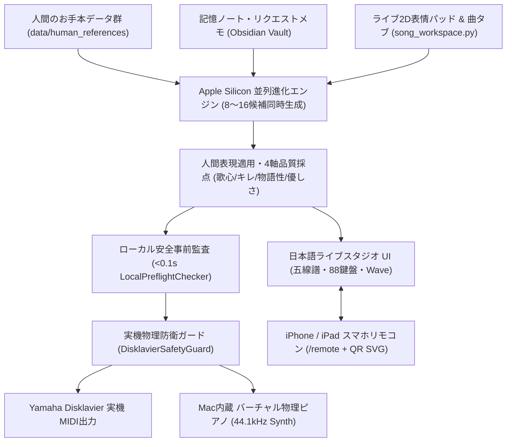
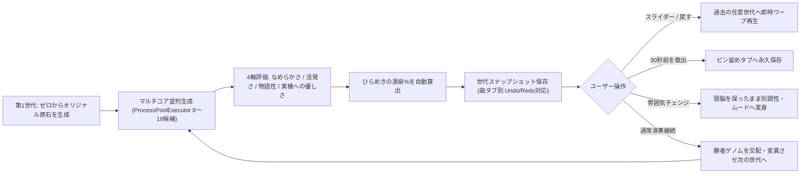
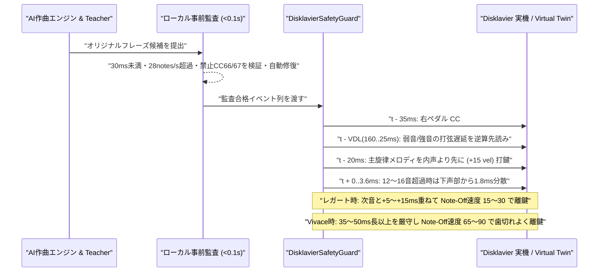
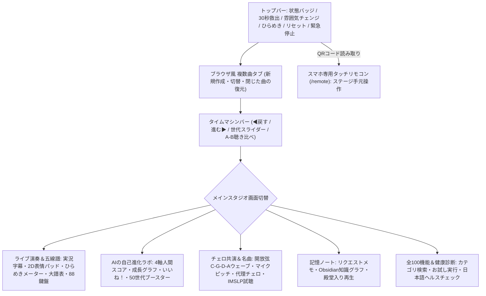

# 🎹 Disklavier-Auto — 人間のお手本に学び自ら進化するAIピアニスト＆ライブ作曲スタジオ

> **「機械的なベタ打ちや固定ボタンの模倣を卒業し、巨匠のレガートと生命力あふれる躍動感をゼロからオリジナル曲として紡ぎ出す、実機Yamaha Disklavier完全安全保護対応ライブ・スタジオ」**

Disklavier-Auto は、チャイコフスキー・ラフマニノフ・ドビュッシー・ショパン・バッハといった巨匠の演奏データから抽出した **「本物の人間の表現法則」** を教師（Teacher）とし、Apple Silicon のマルチコア並列進化計算によって **ゼロからオリジナル楽曲を作曲・自己成長** させるライブパフォーマンス・スタジオです。

クラウドCI（GitHub Actions等）に頼らず、**Macローカル上で `0.1秒未満` のハードウェア物理安全監査（`LocalPreflightChecker`）と並列進化を完結** させる設計になっており、実機 Yamaha Disklavier があってもなくても、Mac内蔵の物理シミュレーション音源＋チェロ共演環境ですぐにライブ体験できます。

---

## ✨ 5つの核心アップデート

1. **自発的なオリジナル作曲と「今のひらめきの源泉」の創発**
   - 不自然な「モチーフ即時吸収」や「〇〇風固定モード」を廃し、ゲノム（音程輪郭・リズム骨格・声部設計）から毎曲ゼロベースで物語を創作。
   - 生成された音楽特性から *「チャイコフスキー的ロマン語法 62%・ラフマニノフ的響き 24%・ドビュッシー的色彩 14%」* のように AI の中から湧き出たインスピレーション比率をリアルタイム表示します。
2. **本物のレガート（Cantabile Legato）＆ 生命力ある活発さ（Vivace）**
   - **真のレガート**: 主旋律に `+5〜+15 ms` のオーバーラップ、低速 Note-Off（`15〜30`）による柔らかな減衰、主旋律の先行発音（`+15〜+25 ms`, 強さ `+12〜+20`）、和音打弦 `-30〜-50 ms` 前の先行ハーフペダル（`CC#64 = 35〜80`）。
   - **活発なVivace/Scherzando**: 最小ノート長 `35〜50 ms`（`30 ms`未満を完全禁止）、ギャップ `20 ms` 以上、歯切れよい離鍵速度 `65〜90`、`12〜15 Hz` 同音連打制限＋華麗なオクターブ分散。
3. **ブラウザ風の複数曲タブ ＋ タイムマシン履歴**
   - `曲タブ` ごとに独立した脳と進化履歴を保持（新規作成・切替・閉じたタブの復元に対応）。
   - `◀ 前の状態に戻す / 進む ▶`・`世代タイムラインスライダー`・`🎧 進化前(A) vs 進化後(B) 聴き比べ`・`⏪ 今の30秒前を救出！（タイムカプセル・ピン留め）`・`🔄 完全リセット / ✨ 雰囲気チェンジ / ⚡ ひらめきスパーク` を搭載。
4. **専門用語ゼロの日本語UI ＆ リアルタイム五線譜 ＆ スマホリモコン**
   - ライブ観客でも一目でわかる日本語ラベル、大譜表（ト音記号・ヘ音記号）の五線譜描画、`MIDI / MusicXML / 44.1kHz WAV` のワンクリック保存。
   - 同じ Wi-Fi 上の iPhone / iPad で QR コードを読み取るだけで開ける専用タッチリモコン（`/remote`）を標準搭載。
5. **100の機能と実機100%保護（`DisklavierSafetyGuard`）**
   - 全100機能を整理した [FEATURES_100.md](file:///Users/avalon/Documents/GitHub/Disklavier-Auto/FEATURES_100.md) とアプリ内の **全100機能エクスプローラー＆日本語システム健康診断** を実装。

---

## 🗺️ アーキテクチャ全体像



---

## 🧬 マルチコア並列自己進化 ＆ タイムマシン・タブの流れ



---

## ⏱️ Yamaha Disklavier 物理安全性・表現制御タイムライン



---

## 🖥️ 日本語ライブスタジオUI ＆ スマホリモコン構成



---

## 🚀 クイックスタート

### 1. 仮想環境の確認とスタジオ起動
```bash
./run_studio.sh
```
または手動でサーバーを起動する場合:
```bash
PYTHONPATH=. .venv/bin/uvicorn src.server.mission_control_server:app --host 0.0.0.0 --port 8765
```
起動後、ブラウザで `http://127.0.0.1:8765` を開くとスタジオが表示されます。画面右上の **「📱 スマホリモコン」** から表示される QR コードを同じ Wi-Fi 上のスマホで読み取ると、`http://<MacのIP>:8765/remote` が即座に開きます。

### 2. ローカル自動テスト＆0.1秒安全監査の実行
外部クラウドCIを使わず、以下のコマンドで物理防衛ガード・自己進化エンジン・100機能・APIルートを一括検証できます：
```bash
PYTHONPATH=. .venv/bin/python tests/test_safety_guard.py
PYTHONPATH=. .venv/bin/python tests/test_autonomous_virtuoso.py
PYTHONPATH=. .venv/bin/python tests/test_studio_overhaul.py
```

---

## 📁 主なディレクトリ構成

- `.agent/skills/` — GitHub実績スキルを参照して構築したプロジェクト専用 Agent Skills（UI設計・人間表現MIDI・Apple Silicon並列化）
- `data/human_references/` — 巨匠ピアノ演奏プロファイル（JSON統計＋お手本MIDI 6種）
- `src/evolution/`
  - `human_reference_teacher.py` — 人間のお手本法則適用、創発的インスピレーション算出、4軸人間スコア採点
  - `actor_critic.py` — マルチコア並列候補生成（8〜16体）＆ 自己進化ゲノム
  - `song_workspace.py` — 複数曲タブ管理＆タイムマシン Undo/Redo/スクラブ永続化
  - `continuous_virtuoso.py` — 途切れないライブストリーミング＆各種リセット・スパーク・30秒救出エンジン
- `src/safety/`
  - `disklavier_safety_guard.py` — Yamaha Disklavier 実機物理保護＆VDL逆算先読みスケジューラ
  - `preflight_checker.py` — `< 0.1s` ローカル完結型 MIDI物理安全性事前監査・自動修復
- `src/features/feature_matrix_100.py` — 全100機能カタログ、MIDI/MusicXML/WAV書き出し、五線譜座標生成、チェロ開放弦C-G-D-Aウェーブ、純Python QR SVG生成、システム健康診断
- `src/server/mission_control_server.py` — FastAPI REST & 60fps WebSocket サーバー
- `src/ui/index.html` & `src/ui/remote.html` — 日本語ライブスタジオUI ＆ スマホ用リモコンUI
- `FEATURES_100.md` — [実装済み全100機能の詳細リスト](file:///Users/avalon/Documents/GitHub/Disklavier-Auto/FEATURES_100.md)
