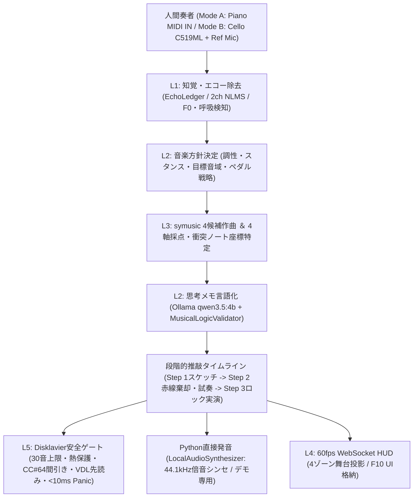
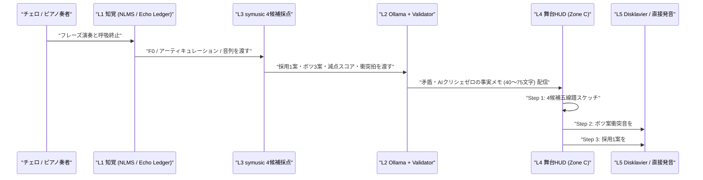
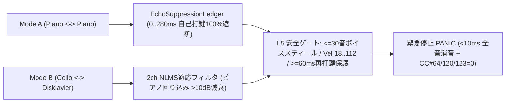
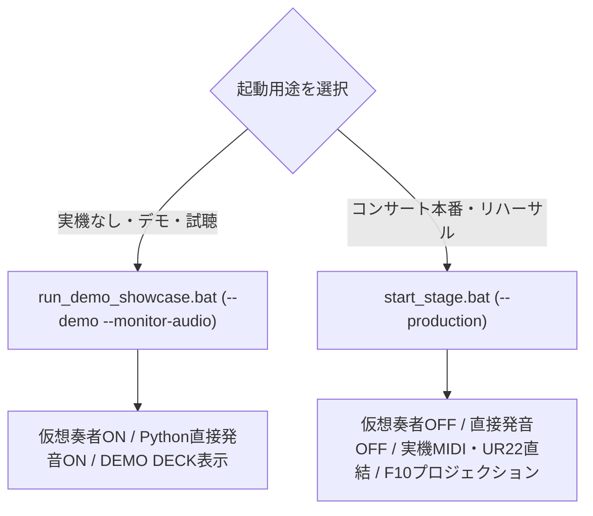

# Disklavier-Auto — 舞台プロセス可視化＆リアルタイム対話作曲システム

> **「作られた結果ではなく、迷い・捨て・選ぶプロセスそのものを音と五線譜で魅せる」**  
> Yamaha Disklavier 実機とチェロ／ピアノ奏者が舞台上で対話し、AIの知覚（L1）→ 4候補作曲と4軸採点（L3）→ 実務的な思考メモ言語化（L2）→ 段階的推敲タイムラインと安全打鍵（L5 / L4）を一本の舞台スコアとして公開投影する Windows 11 リアルタイム共演システムです。

---

## 1. 舞台コンセプト：段階的推敲と事実ベースの思考トレース

1. **段階的推敲タイムライン（Staggered Audition & Rejection Sequence）**:
   - 人間のフレーズ終止（呼吸・ルバート・Una Corda パス合図）を検知すると、4つの対話候補（`A: 対位法的反行案` / `B: コーパス文脈照合案` / `C: 旋法声部連結案` / `D: 中音域密集対照案`）が五線譜に描かれます。
   - 次に **ボツ案3つが1つずつ検証され**、衝突音符（例：チェロ基音 `D3` と短2度でぶつかる音）がヴァーミリオン（`#C83E2B`）で囲まれ、`[× 棄却: 1小節1拍 D3基音と短2度衝突（濁りスコア -42）]` の根拠表示＋赤線添削で棄却されます（デモ時は微弱なピアニッシモ試奏音付き）。
   - 最後に残った1案のみがオフホワイト（`#EAE6DF`）でロックされ、Yamaha Disklavier（またはモニター音源）で演奏される瞬間に五線譜上の進行バーと打鍵中音符が同期発光します。
2. **AIポエム・音楽理論矛盾の完全排除（`MusicalLogicValidator`）**:
   - 「長三度の空虚五度」などの音楽理論的矛盾や、「緊張を高める」「余白を残して」「解決を待つ」といった小説風の陳腐なAI構文をプログラムで検閲・排除しています。
   - 思考メモ（Zone B）は **L1実測音・L3採点結果を受け取った後** に生成され、`【状況】検出音と奏法` ＋ `【却下理由】ボツ案と具体的欠点` ＋ `【決定】採用案と音域・ペダル` の3要素からなる飾り気のない40〜75文字の実用メモのみを投影します。

---

## 2. 起動モードの明確な使い分け（デモ環境 vs 本番実機環境）

| 項目 | デモ・プレゼン・自己実演モード | 本番・リハーサル実機モード |
|---|---|---|
| **起動ランチャー** | **`run_demo_showcase.bat`** | **`start_stage.bat`** |
| **コマンド引数** | `--demo --monitor-audio` | `--production` |
| **仮想チェロ／ピアノ** | **ON**（実機・マイク不要で自動対話） | **OFF**（実機の生入力のみ受付） |
| **PC直接発音シンセ** | **ON**（`LocalAudioSynthesizer` + WebAudio） | **OFF**（音響フィードバック防止のため完全停止） |
| **試奏オーディション音** | **ON**（ボツ案のpp試奏あり・デッキで切替可） | **OFF**（Disklavier実機の確定打鍵のみ） |
| **HUD上の操作デッキ** | 表示（曲想プリセット／ダメ出しMC注入ボタン） | 非表示（`30秒物理遅延＆NLMS校正`＋`F10`プロジェクション） |

---

## 3. クイックスタート

### A. デモ環境（PC単体ですぐに音と推敲を体験する場合）
1. **`run_demo_showcase.bat`** をダブルクリックします（初回環境構築が未了の場合は先に `setup_environment.bat` を実行してください）。
2. 起動と同時にローカル Ollama（`qwen3.5:4b` 等）と Python 直接発音エンジン（`sounddevice` 44.1kHz 倍音シンセ ＋ WebAudio）が有効になり、PCスピーカーから **「仮想チェロの問いかけ → ボツ案の微弱試奏 → AIピアノの応答」** が鳴り始めます。
3. 画面上部の **DEMO DECK** から以下をワンクリックで操作できます：
   - **曲想切替**: `バロック対位法` / `印象派風` / `現代音楽的挑発` / `静謐なコラール`
   - **ダメ出しMC注入**: `中音濁り修正` / `ドライ対位法` / 口頭指示テキスト入力
   - **音声確認**: ヘッダー右側の `[音声出力中: Python Direct Audio + WebAudio]` バッジとリアルタイム `dBFS` レベルメーターで発音状態を確認できます。

### B. 本番環境（Yamaha Disklavier ＋ Steinberg UR22 実機ステージ）
1. **機材の接続と事前設定**:
   - **Yamaha Disklavier**: USB-MIDI または MIDI IN/OUT をPCへ接続し、本体メニューで **`Delay In = OFF`** に設定します（本システムの L5 `offset_ms(pitch, velocity)` が打鍵遅延を逆算先読みするため）。
   - **Steinberg UR22**:
     - `Ch1 (Mic)`: チェロ用クリップマイク **AKG C519ML**（+48V ファンタム電源 ON）
     - `Ch2 (Line/Mic)`: Disklavier 内部の収音用ピアノ参照マイク（2ch NLMS エコーキャンセラのリファレンス信号として使用）
2. **`start_stage.bat`** をダブルクリックして本番モード（`--production`）で起動します。
3. **開演前キャリブレーションとプロジェクション**:
   - 画面上部の **`30秒物理遅延＆NLMS校正`** ボタンを押して、`VDL` 基本遅延と `NLMS ERLE (dB)`、接続中MIDIポート名を確認します。
   - **`記憶初期化`** ボタンを押して Zone D（モチーフ記憶グラフ）をノード `0` にリセットします。
   - 客席への投影時はキーボードの **`F10`** を押すと、上部コントロールバーが完全に格納され、舞台用の純粋な4ゾーン・プロジェクション画面になります。
4. **緊急停止（PANIC）**:
   - 演奏中に異常が発生した場合は、右上の **`PANIC: ALL NOTES OFF`** をクリックします。10ms未満でキューを破棄し、全アクティブ音へ Note-Off および `CC#64=0` / `CC#123=0` / `CC#120=0` を送信して即座に消音します。

---

## 4. 5レイヤー・システムアーキテクチャとディレクトリ構成（Mermaid図解）

### アーキテクチャ全体像


### 段階的推敲タイムラインと安全保護シーケンス


### 物理安全・エコー抑圧フロー


### デモモードと本番モードの運用分岐


```text
Disklavier-Auto/
├── run_demo_showcase.bat         # デモ・プレゼン起動 (--demo --monitor-audio)
├── start_stage.bat               # 本番・リハーサル実機起動 (--production)
├── run_self_check.bat            # 全テスト＋統合整合性＋10回反復ループ検証
├── scripts/
│   └── run_10x_iterative_refinement.py  # 実Ollama＋発音＋安全ゲート10回以上連続検証
├── src/stage/
│   ├── config_scanner.py         # Ollama環境・モデル・MIDIポート診断
│   ├── layer1_perception.py      # L1: Mode A自己打鍵台帳 / Mode B 2ch NLMS・F0・呼吸検知 / CPU音声MC
│   ├── layer2_intent_llm.py      # L2: Ollama構造化思考 + MusicalLogicValidator (矛盾・AI構文検閲)
│   ├── layer3_candidate_composer.py # L3: symusic 4候補生成・4軸評価・衝突ノート座標特定
│   ├── layer5_disklavier_output.py  # L5: 30音物理上限・熱保護・CC#64間引き・VDL先読み・<10ms Panic
│   ├── local_audio_synth.py      # Python直接発音エンジン (sounddevice倍音シンセ + GS Wavetable)
│   └── stage_server.py           # FastAPI & 60fps WebSocket & 段階的推敲タイムライン配信
├── src/ui/
│   └── stage_hud.html            # 4ゾーン舞台エディトリアルHUD (#060608 / #EAE6DF / #5A5852 / #C83E2B)
└── tests/
    └── test_stage_system.py      # 5大安全・知覚・検閲・発音・配信テストスイート
```

### コーパス MIDI データの追加方法
- **`D:\Disklavier-Data`** またはリポジトリ内の **`data/midi/`** に `.mid` / `.midi` ファイルを配置すると、`ZeroConfigCorpusLoader` が起動時に `symusic` で自動スキャンし、Candidate B（コーパス文脈照合案）に反映します。
- MIDI ファイルが0件の場合でも、内蔵のクラシック室内楽シード辞書（J.S. Bach / G. Fauré / J. Brahms / C. Debussy）でエラーなく即時動作します（Zero-Config）。

---

## 5. 自動検証（Self-Check）とトラブルシューティング

### 全自動チェックの実行
```bat
run_self_check.bat
```
以下をすべて順番に自動検証します：
1. `pytest -v tests/test_stage_system.py`（30音制限・Mode A自己打鍵遮断・Mode B NLMS・矛盾検閲・Direct Audio RMS）
2. `pytest -v tests/`（既存全テストスイート）
3. `python validate_system_integrity.py`（7大整合性スイート）
4. `python scripts/run_10x_iterative_refinement.py --iterations 10 --no-device-audio`（実ローカルOllama連続10周の品質・発音検証）

### よくあるトラブルと対処
- **デモ起動時に音が出ない**:
  - Windowsの既定の再生デバイスがミュートになっていないか確認し、画面上部の `Audio Monitor: ON` バッジ横の `dBFS` メーターが動いているか確認してください。ブラウザ側の自動再生制限で WebAudio が待機状態の場合は、画面内の任意ボタン（`次ターン実行` やプリセットボタン）を1回クリックすると WebAudio も同時に解除されます（Python側 Direct Audio はクリック不要で鳴ります）。
- **Ollama がタイムアウトして `rule_fallback` になる**:
  - `ollama list` で `qwen3.5:4b` が導入済みか確認し、`ollama serve` が `127.0.0.1:11434` で起動していることを確認してください。本システムは `think=False`・`keep_alive="15m"` で高速応答するよう設定されています。
- **本番モードで自分のピアノ音をAIが二重に拾ってしまう**:
  - `Mode A: Piano ↔ Piano` を選択しているか確認してください。`EchoSuppressionLedger` が AI 送信ノートを台帳登録し、物理帰還ウィンドウ `[0ms, 280ms]` 内の自己打鍵エコーを 100% 遮断します。
