# DISKLAVIER STUDIO / Disklavier-Auto

**会場 M1 MacBook Pro ⇔ 自宅 RTX 3070 PC ハイブリッド分離構成・6並列リアルタイム対話作曲 ＆ 6段階論理思考トレース統合システム（YAMAHA Disklavier 実機 ＋ WebAudio 公開デモ）**

DISKLAVIER STUDIO は、アコースティックの生演奏者（チェロ / ピアノ）と YAMAHA Disklavier 自動演奏グランドピアノが舞台上で聴き合い、両手ポリフォニー・和声リアライズ・左右デュアルペダル（左 = `UNA CORDA CC#67` / 右 = `DAMPER CC#64`）をリアルタイム共作する舞台対応AIシステムです。

本番会場（名古屋工業大学での接続実証テスト等）へ RTX デスクトップ PC を持ち込めない環境制約を解消するため、**「会場 M1 MacBook Pro（超低遅延 MIDI / UR22 音響 / 30音安全装置 / HUD）」** と **「自宅 Windows 11 RTX 3070 PC（Ollama LLM / NotaGen / 4候補並列作曲推論サーバ）」** を Tailscale / Cloudflare Tunnel 経由で外部結合し、遅延超過・回線切断時にも演奏を止めず M1 Mac ローカル推論へ切り替える無停止フェイルオーバー機構を備えています。

- **公開 WebAudio ショーケース (GitHub Pages)**: [https://ai-avalon.github.io/Disklavier-Auto/](https://ai-avalon.github.io/Disklavier-Auto/)
- **GitHub Wiki トップページ**: [AI-Avalon/Disklavier-Auto Wiki Home](https://github.com/AI-Avalon/Disklavier-Auto/wiki)（リポジトリ内ミラー: [docs/wiki/Home.md](docs/wiki/Home.md)）
- **実測性能・負荷・耐障害レポート**: [docs/PERFORMANCE_AND_READINESS_REPORT.md](docs/PERFORMANCE_AND_READINESS_REPORT.md)
- **題材起点UIデザイン・書体設計書**: [docs/DESIGN_DIRECTION.md](docs/DESIGN_DIRECTION.md)
- **作曲専用OSS比較設計 / 実機点検手順**: [docs/COMPOSITION_ENGINES.md](docs/COMPOSITION_ENGINES.md) | [docs/HARDWARE_TEST_PROCEDURE.md](docs/HARDWARE_TEST_PROCEDURE.md)

---

## 1. 実測性能・実用化判定サマリー（RTX 3070 実機・全4スイート PASS）

`scripts/run_production_readiness_tests.py` による実機計測（2026-11-23 UTC 実行、[詳細レポート](docs/PERFORMANCE_AND_READINESS_REPORT.md)）の観測値です。

| 検証カテゴリー | 計測項目 | 実測結果 | 目標基準 | 判定 |
| --- | --- | --- | --- | --- |
| **リアルタイム応答** | L1 音響知覚 + 2ch NLMS (`200` ブロック) | 平均 `0.422 ms` / P95 `0.652 ms` | P95 < `23.22 ms` | **PASS** |
| **リアルタイム応答** | L3 4候補並列作曲 (`10` ターン) | 平均 `16.15 ms` / P95 `17.51 ms` (`2.48x`) | 平均 < `100.0 ms` | **PASS** |
| **リアルタイム応答** | Ollama LLM (`qwen3.5:4b`, `think=False`) | ウォーム TTFT `53.3 ms` (全体 `514.6 ms`) | TTFT < `3000 ms` | **PASS** |
| **リアルタイム応答** | WebSocket `/ws/stage` 60fps 配信 | 平均 `20.81 ms` / P95 `29.195 ms` | P95 < `60.0 ms` | **PASS** |
| **物理MIDI出力精度** | L5 Disklavier スケジューラ精度 (`16` 音) | 平均 `0.076 ms` / P95 `0.323 ms` | P95 < `5.0 ms` | **PASS** |
| **緊急保護** | 緊急 `PANIC` 全消音応答時間 | `0.082 ms` (終了後残存発音 `0` 音) | < `10.0 ms` | **PASS** |
| **回線劣化・断線耐性** | 5段階遅延/遮断プロキシ試験 (`timeout=1800ms`) | 退避 `2` 回・自動復帰 `1` 回・クラッシュ `0` 件 | 音切れ/例外 `0` | **PASS** |
| **55ターン耐久・VRAM** | 混在55ターン / RTX 3070 ピーク VRAM | ピーク `4.55 / 8.0 GB` / メモリ増分 `+1.33 MB` | <= `8.0 GB` / < `25 MB` | **PASS** |
| **音響/MIDI安全柵** | Mode A 自己打鍵漏れ / Mode B 誤検知 / 衝突・単音 | `0` 件 / `0` 件 (ERLE `+95.07 dB`) / `0` / `0` | すべて `0` 件 | **PASS** |
| **UI・スマホ監査** | Playwright (`1920`, `1366`, `390`, `320px`) | `23` 状態全 PASS・エラー `0`・`CLS = 0` | 横溢 `0px` (スマホ) | **PASS** |

---

## 2. 4つの演奏・作曲モードの使い分け

1. **`[1] チェロ対話`（Mode B: Cello ⇄ Disklavier）**:
   - AKG C519ML（UR22 Ch1）とピアノ参照（UR22 Ch2）から 2ch `NLMSEchoCanceller` でピアノ回り込みを除去し、YIN F0・ビブラート・奏法・呼吸終止を検出。`MIDIGPTAccompanimentEngine` (CPU)＋4候補並列作曲プールがチェロ帯域を避けて応答します。
   - 現場テスト開始時は **「NLMS 較正」** ボタンで会場残響を学習させてください。
2. **`[2] ピアノ対話`（Mode A: Human Piano ⇄ AI Piano）**:
   - Disklavier 生打鍵 MIDI IN（または画面鍵盤クリック / PCキーボード `A W S E D F T G Y H U J K`）に即時応答。`EchoSuppressionLedger` が AI 送信ノートを `[0ms, 280ms]` 窓で追跡し、機械ソレノイド由来の自己打鍵ループバックを 100% 除外します。
3. **`[3] NotaGen / LLM 一から作曲ライブ`**:
   - 日本語コンセプト・調性・種モチーフ・小節数（4〜16小節）を指定し、`PeriodStructurePlanner`＋`NotaGenSmallQuantizedModel` / `llm_json`＋`LivePolyphonyHarmonyGuard` で前楽節（半終止）→後楽節（完全終止）を1小節ずつストリーミング生成・演奏します。
4. **`[4] デモ試聴・アーカイブ`**:
   - 品質監査済み 100 作品（Mode B 50曲 / Mode A 50曲、高音質 MP3 10曲）を検索・試聴し、4声レイヤー独立 `MUTE` / `SOLO`、ハーモニック X-Ray、タイムマシン大譜表で解析。選択中の作品の調・和声文脈から **「この余韻から AI作曲を再開」** で `[3]` モードへ遷移できます。

---

## 3. ライブハイブリッド構成・セットアップ手順（自宅 RTX ＋ 会場 M1 Mac）

### 3.1 自宅 Windows 11 PC (RTX 3070 8GB) 側 — 常駐推論ホスト

自宅 PC はスリープ設定を「なし」にし、ポート TCP `8090` のファイアウォール許可と強力な Bearer トークンを設定して起動します（未設定時はセッション限定の一時トークンがコンソールと `data/telemetry/remote_gpu_token.txt` に表示されます）。

```bat
cd /d d:\Users\gakuto\Documents\GitHub\Disklavier-Auto
set DISKLAVIER_API_TOKEN=YourStrongTokenHere
start_remote_gpu_host.bat
```

- **特徴**: Ollama (`OLLAMA_FLASH_ATTENTION=1`, `OLLAMA_KV_CACHE_TYPE=q8_0`, `OLLAMA_KEEP_ALIVE=-1`) の自動起動確認、Tailscale IPv4 の自動表示、異常終了時 **3秒自動再起動ウォッチドッグ** 付きで `src/stage/remote_gpu_server.py` を常駐させます。
- **予備外部トンネル（大学Wi-Fi等で Tailscale VPN が遮断された場合）**:
  ```bat
  start_external_tunnel.bat
  ```
  `cloudflared tunnel --url http://127.0.0.1:8090`（または環境変数 `CLOUDFLARE_TUNNEL_TOKEN` による固定トンネル）を自動監視・再接続し、`https://xxxx.trycloudflare.com` URL を発行します。

### 3.2 会場 M1 MacBook Pro 側 — セットアップ・疎通診断・本番起動

1. **初回環境構築（`.venv` + CoreMIDI + CoreAudio + MPS）**:
   ```bash
   git clone https://github.com/AI-Avalon/Disklavier-Auto.git
   cd Disklavier-Auto
   ./setup_mac.sh
   ```
   *(PortAudio 不足時は事前に `brew install portaudio` を実行してください)*
2. **実機機材結線（YAMAHA Disklavier ＋ Steinberg UR22）**:
   - **YAMAHA Disklavier 本体メニュー**: **`Delay In = OFF`** に設定（L5 の物理ソレノイド着火先読み `offset_ms` による精密同期のため必須）。
   - **USB-MIDI**: M1 Mac ⇔ Disklavier を直結（`CoreMIDI` で認識）。
   - **UR22 Ch1 (48V ON)**: AKG C519ML（チェロ収音）、**UR22 Ch2**: ピアノ回り込み参照信号。
3. **外部接続 ＆ RTT・認証・フェイルオーバー事前診断**:
   ```bash
   source .venv/bin/activate
   python3 scripts/check_remote_connection.py \
     --url "http://<自宅TAILSCALE_IP>:8090" \
     --token "<DISKLAVIER_API_TOKEN>"
   ```
   Ping RTT (min/avg/P95)、Bearer `401/200` 認証、実推論 `/api/v1/infer/deliberate` E2E 遅延、`WS /ws/v1/stream_compose`、およびタイムアウト退避を一発で PASS/FAIL 判定します（高速確認は `--quick`）。
4. **舞台本番起動（ポート自動回避・CoreMIDI自動検出・黒箱記録 ON）**:
   ```bash
   ./start_mac_stage.sh \
     --remote-url "http://<自宅TAILSCALE_IP>:8090" \
     --token "<DISKLAVIER_API_TOKEN>" \
     --mode AUTO \
     --production
   ```
   - 接続先モードはトップバーまたは `/stage` HUD から **`AUTO`** / **`REMOTE_RTX_ONLY`** / **`MAC_LOCAL_ONLY`** を即時切替可能です。
   - **ショートカット**: `F10`（舞台投影クリーン表示 `#141517` 切替）、`Esc`（モーダル閉または `< 1ms` 緊急 `PANIC` 全消音）。

---

## 4. リアルタイム6段階「論理思考トレース」＆ 現場ブラックボックス全記録

実機接続テスト中に「AIがなぜその和声・声部・ペダルを選び、どう補正したか」を事後含め完全に解明できます。

- **UI「論理思考トレース (6段階)」タブ**（`/studio` モード1/2・`/stage`・公開デモすべてに搭載）および `GET /api/stage/logic_trace` が毎ターン以下をリアルタイム構造化表示します:
  1. **`L1_PERCEPTION`**: 検出音名・F0 (Hz)・和音推定・奏法・呼吸終止スコア・NLMS ERLE減衰量・自己打鍵抑圧数
  2. **`TOKEN_ECON`**: 圧縮前後トークン数・削減率・LLM へ送信した要点文脈
  3. **`L2_LOGIC_CHAIN`**: 第1〜4幕、和声機能仮説、ボイシング構造、CC#64/CC#67 ペダル計画
  4. **`L3_CANDIDATES`**: 案A〜Dの協和度/ポリフォニー/歌唱性/ペダル連動スコアと具体的な棄却理由
  5. **`REALIZER_DIFF`**: `HarmonicBeautyRealizer` による単音抜け修復率・偶発的不協和音 (`count_vertical_clashes`) の削減前後差分
  6. **`TIMING_BUDGET`**: 知覚 (ms) / ネットワークRTT (ms) / GPU推論 (ms) / VDL先読み (ms) / 総応答時間 (ms)
- **現場セッション全自動レコーダー (`src/stage/field_recorder.py`)**:
  - `--production` 起動時（または `--record` / トップバー「黒箱記録」ON）に `recordings/session_YYYYMMDD_HHMMSS/` へ **① `midi_events.jsonl`＋`disklavier_io.mid`**、**② `ur22_audio.wav` (2ch 44.1kHz)**、**③ `logic_trace.jsonl`**、**④ `network_latency.jsonl`**、**⑤ `session_manifest.json`** を相対タイムスタンプ同期で保存します。
  - 会場終了後は `FieldSessionReplayer.load_session(Path("recordings/session_..."))` / `iter_timeline(...)` で実機なし完全リプレイ解析が可能です。

---

## 5. システム構成・ハイブリッド通信・パイプライン（Mermaid 図解）

### 5.1 会場 M1 Mac ⇔ 自宅 RTX 3070 外部ハイブリッド ＆ 無停止フェイルオーバー構成

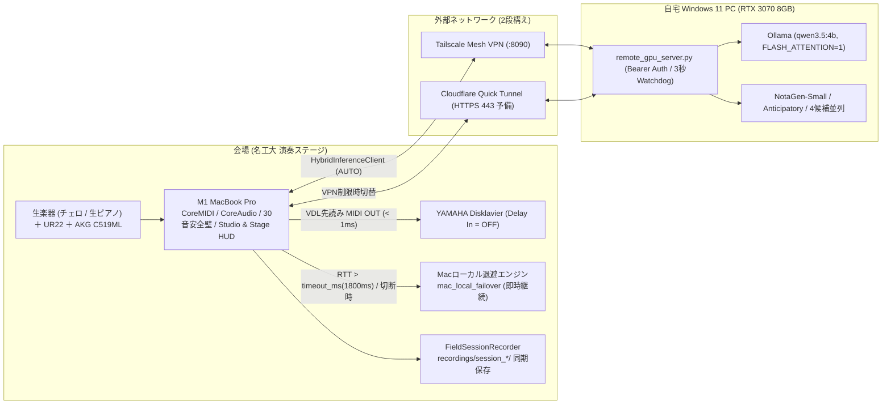

### 5.2 6並列リアルタイム作曲・低遅延パイプライン（Worker 1〜6）

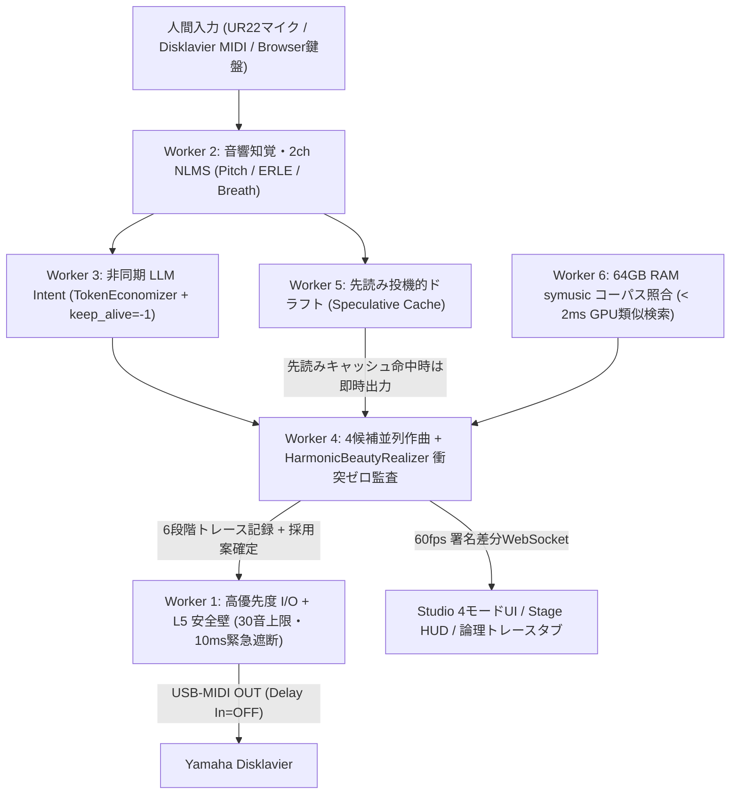

### 5.3 RTX 3070 (VRAM 8GB) 動的デュアルプロファイル状態遷移

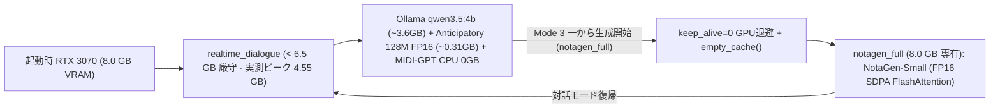

### 5.4 NotaGen-Small 楽節計画 ＆ 小節逐次生成シーケンス

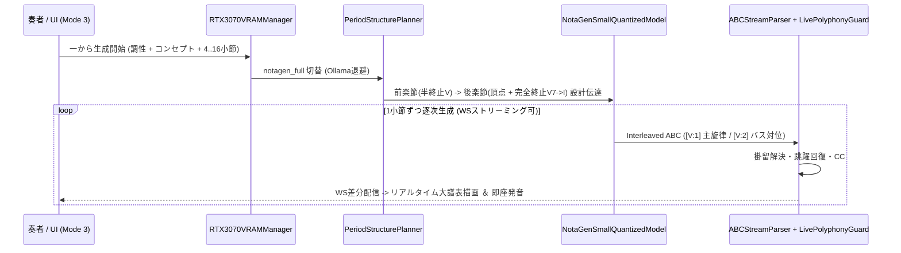

### 5.5 CI 環境分離・Playwright 視覚監査 ＆ GitHub Pages / Wiki 運用

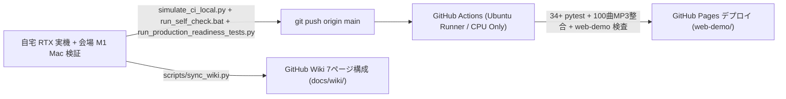

---

## 6. UI アートディレクション ＆ 画面キャプチャ（Playwright 全23状態監査済）

`.agents/skills/anything-frontend-art-direction/` の題材起点設計手法・247作品の書体調査データ・4チェックリストを適用し、以下の書体階層と 5大舞台UI規約を全画面（`/studio`, `/stage`, `web-demo/`）で実現しています（根拠詳細: [docs/DESIGN_DIRECTION.md](docs/DESIGN_DIRECTION.md)）。

- **書体階層**: タイトル・見出し **`Shippori Mincho` + `Cormorant Garamond`**（2案比較のうえ室内楽スコアと計器調和のため採用）、本文UI **`Noto Sans JP`**、数値テレメトリ **`JetBrains Mono`**（`tabular-nums` 等幅数字）。
- **5大舞台制約 & A11y**: ①カード枠線・影ゼロ（下線1px＋余白）、②フラット単色グレー `#1C1D20`（`F10` 時 `#141517`）、③DOM順固定 `:nth-child` 極薄 SVG 幾何模様、④カード自動入替ゼロ（5秒監視 `CLS = 0`）、⑤最小可視フォント `>= 13.0px`（`.sr-only` 含む）＆ スマホ `390px`/`320px` 横溢 `0px`、スキップリンク・モーダルフォーカストラップ・`prefers-reduced-motion: reduce` 準拠。

| Studio Mode [1] チェロ対話 (1920×1080) | 6段階 論理思考トレース インスペクタ (1920×1080) |
| :---: | :---: |
|  | 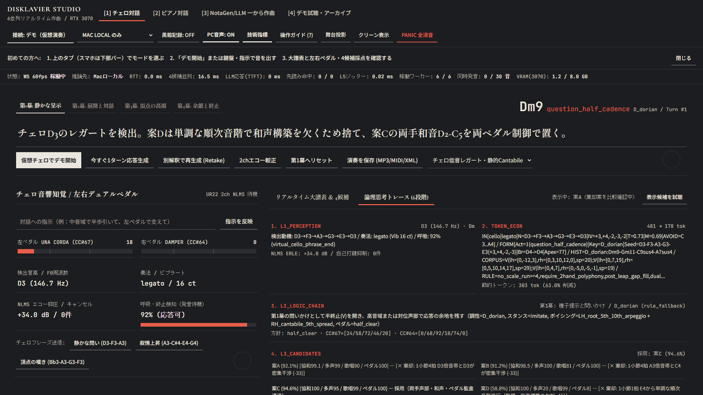 |

| Studio Mode [2] ピアノ対話 (1920×1080) | Studio Mode [3] NotaGen ライブ (1920×1080) | Studio Mode [4] 100曲アーカイブ (1920×1080) |
| :---: | :---: | :---: |
| 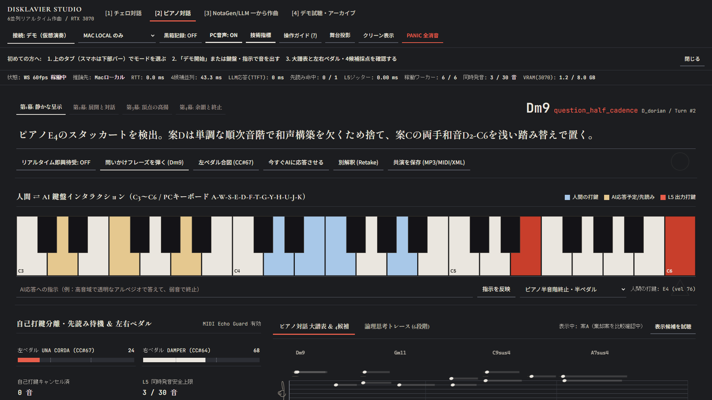 |  | 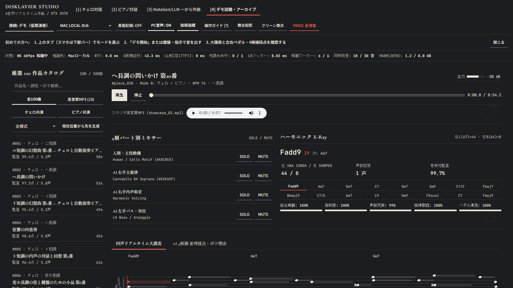 |

| Stage HUD (`/stage`) | F10 舞台投影クリーン表示 | GitHub Pages 公開デモ (1920×1080) |
| :---: | :---: | :---: |
|  |  | 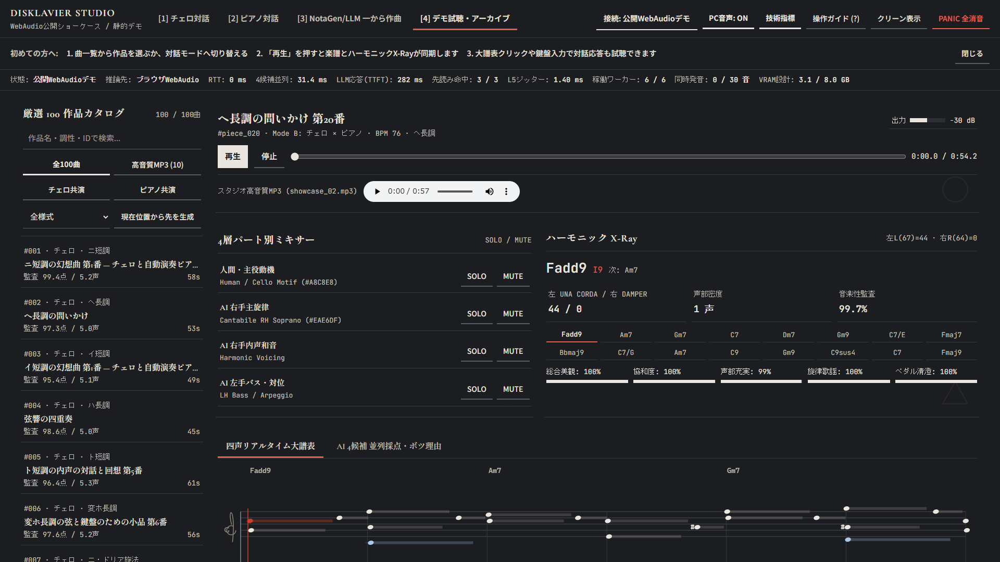 |

| スマホ Mode [1] (390×844) | スマホ 論理思考トレース (390×844) | スマホ Mode [4] ライブラリ (390×844) |
| :---: | :---: | :---: |
| 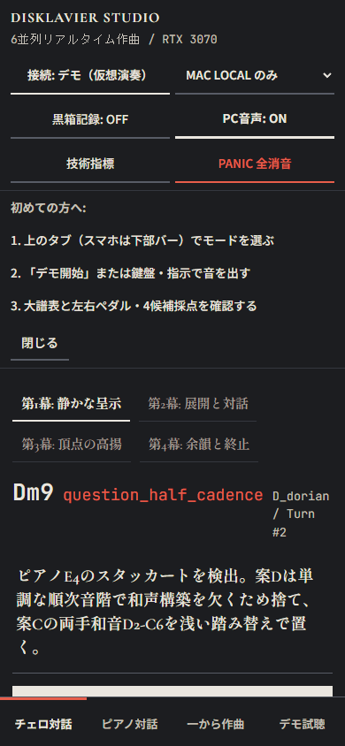 | 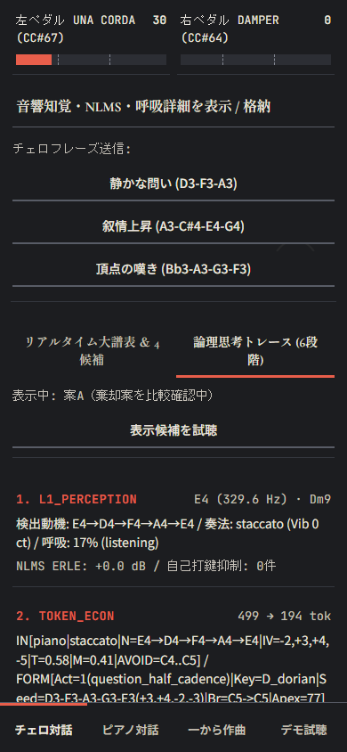 | 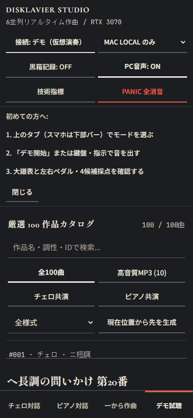 |

---

## 7. GitHub Wiki 7ページ案内（ローカルミラー `docs/wiki/`）

| ページタイトル | 主な記載内容 | GitHub Wiki URL | ローカルミラー |
| --- | --- | --- | --- |
| **Home** | 全体ナビ・前夜/当日の最短起動コマンド | [Wiki Home](https://github.com/AI-Avalon/Disklavier-Auto/wiki) | [Home.md](docs/wiki/Home.md) |
| **01. ハイブリッド＆6並列設計** | Mac⇔RTX分離構成・無停止フェイルオーバー・VRAM調停 | [01-Architecture-and-Hybrid-RTX-Mac](https://github.com/AI-Avalon/Disklavier-Auto/wiki/01-Architecture-and-Hybrid-RTX-Mac) | [01-Architecture](docs/wiki/01-Architecture-and-Hybrid-RTX-Mac.md) |
| **02. 導入・外部公開・起動手順** | Windows常駐 `.bat`・Tailscale/Cloudflare・Macセットアップ | [02-Installation-Windows-RTX-and-M1-Mac](https://github.com/AI-Avalon/Disklavier-Auto/wiki/02-Installation-Windows-RTX-and-M1-Mac) | [02-Installation](docs/wiki/02-Installation-Windows-RTX-and-M1-Mac.md) |
| **03. 舞台運用・実機・黒箱記録** | Disklavier `Delay In=OFF`・UR22結線・4モード・`FieldSessionRecorder` | [03-Live-Stage-Operations-and-Hardware](https://github.com/AI-Avalon/Disklavier-Auto/wiki/03-Live-Stage-Operations-and-Hardware) | [03-Operations](docs/wiki/03-Live-Stage-Operations-and-Hardware.md) |
| **04. 6段階論理トレース＆音楽法則** | `L1_PERCEPTION`〜`TIMING_BUDGET` 詳解・和声衝突解除設計 | [04-Logic-Trace-and-Musical-Engine](https://github.com/AI-Avalon/Disklavier-Auto/wiki/04-Logic-Trace-and-Musical-Engine) | [04-Logic-Trace](docs/wiki/04-Logic-Trace-and-Musical-Engine.md) |
| **05. UIアートディレクション＆A11y** | 247作品書体調査・タイトル書体比較・チェックリスト検証 | [05-UI-Design-Direction-and-Accessibility](https://github.com/AI-Avalon/Disklavier-Auto/wiki/05-UI-Design-Direction-and-Accessibility) | [05-UI-Direction](docs/wiki/05-UI-Design-Direction-and-Accessibility.md) |
| **06. 実測性能・負荷試験・トラブル対応** | 4スイート実測値・QAコマンド・現場トラブル即時対処表 | [06-Performance-Benchmarks-and-QA](https://github.com/AI-Avalon/Disklavier-Auto/wiki/06-Performance-Benchmarks-and-QA) | [06-Benchmarks](docs/wiki/06-Performance-Benchmarks-and-QA.md) |

- Wiki 同期スクリプト: `python scripts/sync_wiki.py`

---

## 8. クイックトラブルシューティング ＆ 全テストコマンド

- **大学Wi-Fi等で Tailscale VPN に繋がらない**: 自宅 PC 側で `start_external_tunnel.bat` を実行し、表示される `https://*.trycloudflare.com` URL へ切り替えてください。
- **実機 Disklavier の発音が約 0.5 秒遅れる**: Disklavier 本体の設定メニューで必ず **`Delay In = OFF`** に設定してください。
- **初回 LLM 応答だけ遅い**: 演奏前に一度 `scripts/check_remote_connection.py` を走らせると Ollama モデルが VRAM 常駐 (`OLLAMA_KEEP_ALIVE=-1`) され、2回目以降はウォーム TTFT ~`53 ms` になります。

```bat
:: 1. 完全自己点検 (pytest + 整合性検査 + 100曲MP3 + CI模擬 + Playwright + Ollama 10回反復)
run_self_check.bat

:: 2. 実用化総合負荷・回線障害・55ターン・Playwright 全4スイート試験
.venv\Scripts\python.exe scripts/run_production_readiness_tests.py --update-docs-images

:: 3. GitHub Actions 同等軽量 CI 模擬
.venv\Scripts\python.exe scripts/simulate_ci_local.py
```
