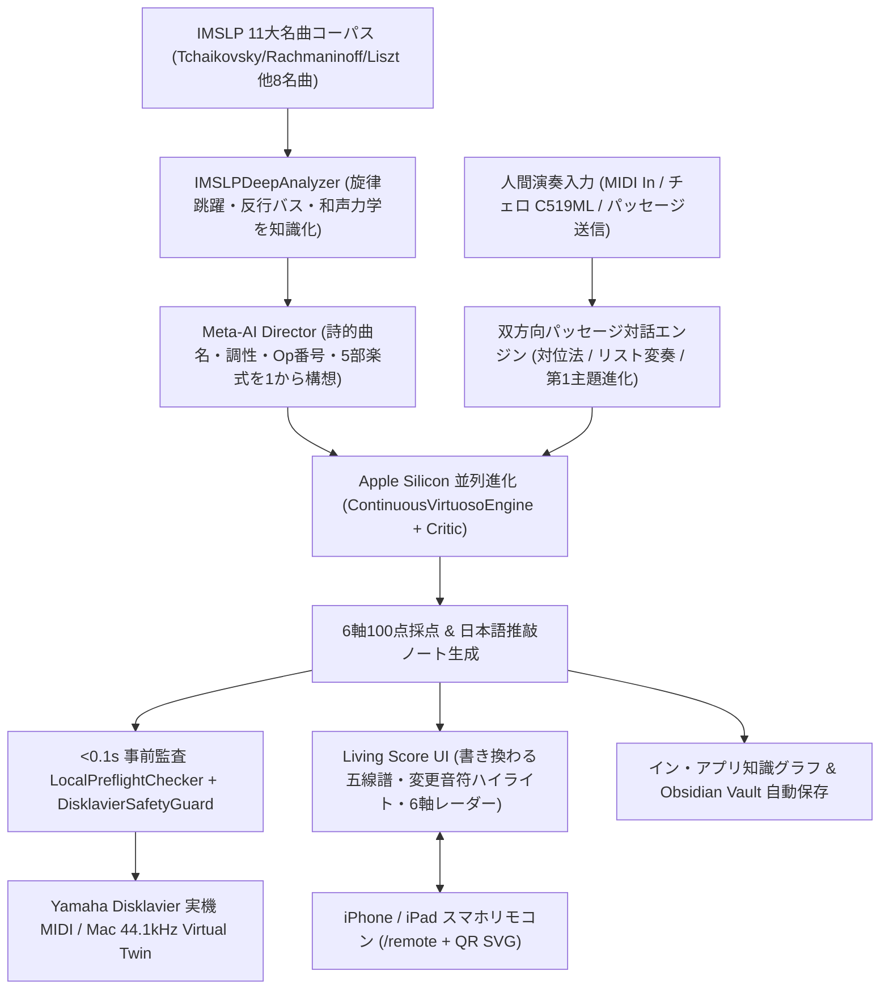
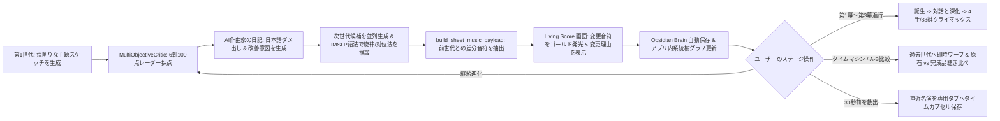
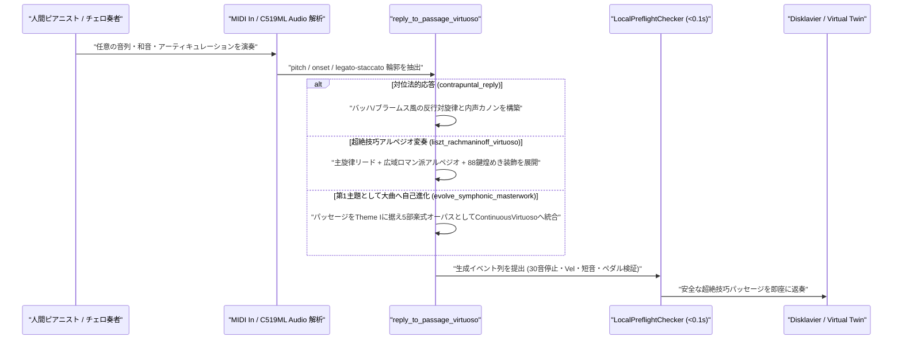
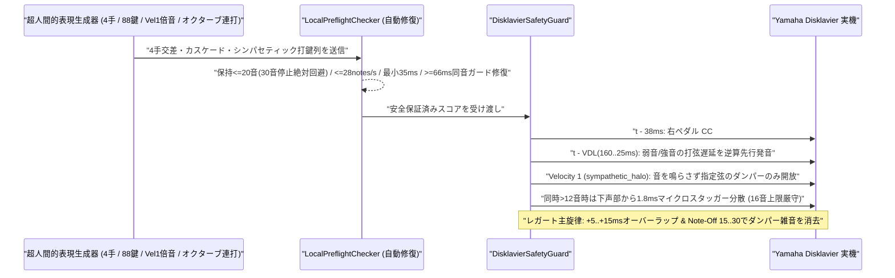
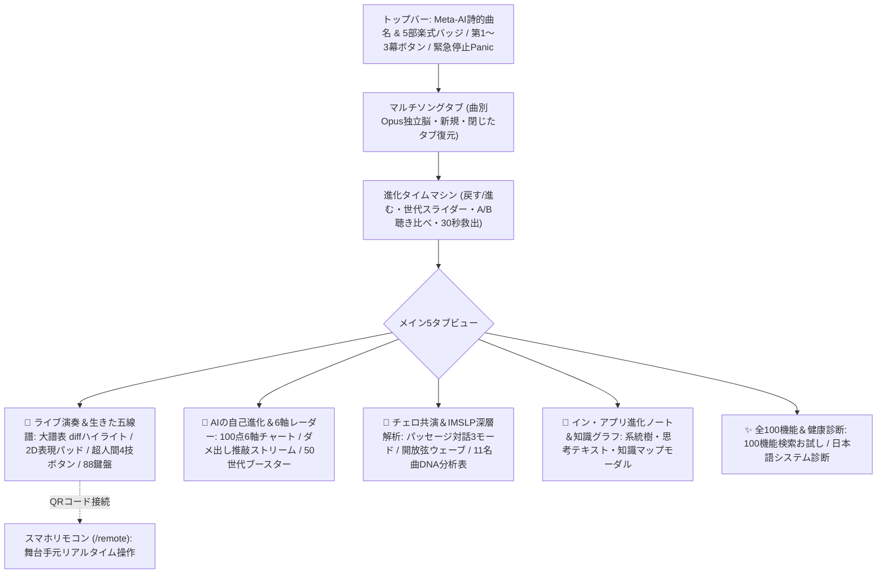

# 🎹 Disklavier-Auto — IMSLP深層学習ヴィルトゥオーゾ＆自己進化ライブ作曲スタジオ

> **「IMSLPの名曲群を深く解析して1から本物の旋律と楽曲を創り上げ、その『推敲・自己進化の過程』を五線譜・文字・6軸採点で美しく可視化し、人間がピアノやチェロで弾いたパッセージに超絶技巧で応え、自動演奏ピアノ（Yamaha Disklavier）ならではの自然かつ派手で美しい演奏を繰り広げる統合マスターシステム」**

Disklavier-Auto は、チャイコフスキー・ラフマニノフ・リスト・ショパン・ドビュッシー・バッハ・サン＝サーンス・フォーレ・ブラームス・メンデルスゾーンの **11大IMSLPクラシック名曲** から抽出した **深層音楽DNA（IMSLP Deep Musical DNA）** を礎とし、Apple Silicon マルチコア並列進化と **Meta-AI Director** によって、詩的な曲名・明確な5部楽式を持つオリジナル楽曲を1から作曲・推敲・上演するライブスタジオです。

さらに外部クラウドCIや外部Obsidianアプリへの切り替えを必要とせず、**Macローカル上の0.1秒未満物理安全監査（`LocalPreflightChecker` ＋ `validate_system_integrity.py`）** と **イン・アプリ音楽知識グラフ＆進化ノートビューア** をブラウザ画面内に完全統合しています。

---

## ✨ 統合マスターシステムの5大革新

1. **🎼 「作られた結果」ではなく「創り上げていく過程」を見せる Living Score ＆ 6軸レーダー**
   - 第1世代（荒削りな原石スケッチ）→ AI作曲家の文字による自己ダメ出しと推敲理由 → 五線譜上の変更音符ハイライト（`mutated` 光彩＋理由表示＆$pp \sim ff$ ダイナミクス）→ 第10世代（対位法・ロマン派和声）→ 第30世代+（人間的ルバート＋超絶技巧クライマックス）という **創作のドラマ** を視覚・聴覚の両面で体験できます。
   - **6軸・100点満点レーダーチャート**（旋律の美しさ／和声のドラマ／対位法／人間らしい自然さ／派手さ・超絶技巧／Disklavier物理優しさ）が毎世代ライブ更新されます。

2. **🧠 IMSLP 11大名曲 Deep Musical DNA 解析 ＋ Meta-AI Director による1からの本格作曲**
   - 旋律線（順次進行 vs 6度・8度跳躍、クライマックス配置）、和声と反行バスの力学、広域アルペジオ／内声オブリガートを `IMSLPDeepAnalyzer` が数値解析し知識ベース化。
   - **Meta-AI Director** が「①歌う主旋律」「②反行バスと対旋律」「③5段階楽式（Ⅰ.静謐な序奏 → Ⅱ.主題提示 → Ⅲ.対位法的展開 → Ⅳ.超絶技巧クライマックス → Ⅴ.余韻のコーダ）」「④日本語＆欧文タイトル・調性・Op番号（例：*『幻想曲 変ロ短調「蒼き星の奔流」Op.14』*）」を1から構築します。

3. **🎹 Disklavierならではの「人間的自然美」×「超人間的4大ヴィルトゥオーゾ表現」**
   - **人間的リアリズム**: 主旋律レガート `+5〜+15 ms` 重ね＆Note-Off速度 `15〜30`、Melody Lead（`+15〜+22` vel / `+15〜+25 ms`先行）、アゴーギク呼吸、和音打弦 `-30〜-50 ms` 先行ハーフペダル（`CC#64 = 35〜80`）。
   - **超人間的4大技巧**:
     1. **4本の手による立体交差レイヤリング**（重低音バス＋2声チェロ対旋律＋主旋律＋高音真珠装飾）
     2. **88鍵クリスタル・カスケード**（同時16音上限を遵守しつつ1〜2ms微細スタッガーで88鍵を縦断）
     3. **サイレント打鍵（`Velocity 1` `sympathetic_halo`）倍音共鳴オーケストレーション**
     4. **オクターブ分散オルタネート連打**（12〜15Hz同音連打物理限界を遵守しオクターブへ華麗に分散）

4. **🗣️ ピアノ / チェロ双方向ヴィルトゥオーゾ対話（3モード即時返奏）**
   - 人間が鍵盤（MIDI In）またはチェロマイク（C519ML Audio In）／スタジオテスト入力で弾いたパッセージを即時認識し、3つのモードで弾き返します：
     - **① 美しい対位法的応答** (`contrapuntal_reply`)
     - **② リスト／ラフマニノフ風 超絶技巧アルペジオ変奏** (`liszt_rachmaninoff_virtuoso`)
     - **③ そのパッセージを第1主題として1から大曲へ自己進化** (`evolve_symphonic_masterwork`)

5. **📓 外部Obsidian不要！イン・アプリ音楽知識グラフ＆進化ノートビューア ＋ 桜井流ステージ演出統合**
   - `obsidian_vault/` へのMarkdown＋MIDI自動保存を維持したまま、画面内の **「イン・アプリ進化ノート＆知識グラフ」タブ＆拡大モーダル** で系統樹・思考テキスト・知識ネットワーク・採用理由を完結閲覧できます。
   - `.agent/skills/sakurai-virtuoso-direction/SKILL.md`（溜め・ヒットストップ・振れ幅対比・音響階層・リスクとリワード）を演出設計に統合しています。

---

## 🗺️ 図1：マスター統合アーキテクチャ全体像



---

## 🧬 図2：「創り上げる過程」を見せる自己進化＆Living Score 推敲ループ



---

## 🗣️ 図3：ピアノ／チェロ双方向パッセージ対話シーケンス



---

## ⏱️ 図4：Yamaha Disklavier 物理安全防衛・VDL先読み＆超人間的4大技巧



---

## 🖥️ 図5：イン・アプリ完結スタジオ画面・知識グラフ＆マルチソングタブ構造



---

## 🎭 舞台演出＆機能ショーケース・ガイド（Stage Performance Showcase Guide）

実際のデモンストレーションやコンサートリハーサルでシステムの魅力を最大限に引き出す **5つのショーケース・シナリオ** と **3幕ステージ台本** です。

### 🌟 5つのショーケース・シナリオ

1. **シナリオ1：ゼロからの本格創作ドラマ（創作過程の完全可視化）**
   - 手順：`ライブ演奏＆生きた五線譜` タブで「第1世代スケッチ」から並列進化を開始し、`AIの自己進化＆6軸レーダー` の日本語推敲ログと五線譜の **ゴールド発光音符（今回書き換わった箇所＋理由）** に注目します。
   - 見どころ：荒削りな旋律が世代を重ねるごとに6度跳躍や対位法的反行バスを獲得し、Meta-AIが付けた曲名『幻想曲 変ロ短調「蒼き星の奔流」Op.14』へと育つ過程が見えます。

2. **シナリオ2：生演奏パッセージとの双方向ヴィルトゥオーゾ対話**
   - 手順：チェロ共演タブ（またはステージ上部パッセージ欄）からピアノ鍵盤またはチェロ音列を入力し、**「対位法的応答」→「リスト／ラフマニノフ風超絶技巧変奏」→「この主題から大曲へ自己進化」** の3モードを順に試します。
   - 見どころ：数音のモチーフが一瞬で88鍵にわたるロマン派の奔流へと昇華し、そのまま新Opusの第1主題としてタイムマシン履歴へ組み込まれます。

3. **シナリオ3：Disklavier 超人間的4大ヴィルトゥオーゾ表現の聴き比べ**
   - 手順：`超人間的Disklavier 4大技巧` パネルの4ボタン（**「4本の手 立体交差」「88鍵クリスタル・カスケード」「Velocity 1 倍音共鳴」「オクターブ高速トレモロ」**）を順次クリックします。
   - 見どころ：人間10度限界を超える4声同時歌わせや、同時16音制限を守った1〜2msカスケード、音を出さずに弦を共鳴させるVelocity 1倍音ハローを、安全な物理監視メータとともに体感できます。

4. **シナリオ4：外部Obsidian不要のイン・アプリ音楽知識グラフ＆IMSLP深層DNA**
   - 手順：`📓 イン・アプリ進化ノート＆知識グラフ` タブおよび **「知識グラフを拡大表示」ボタン**（`<dialog>` モーダル）、さらに `🎻 チェロ共演＆IMSLP深層解析` 内の **11名曲DNAサマリー** を開きます。
   - 見どころ：アプリ画面から離れることなく、チャイコフスキー／ラフマニノフ／リスト等の跳躍率・対位法傾向と、AIの思考日記・進化系統樹を一望できます。

5. **シナリオ5：マルチソング・タイムマシンA/B比較＆30秒タイムカプセル救出**
   - 手順：曲タブを「＋ 新しい曲を作る」で複数立ち上げ、片方を進化させたあと **「A(初期) vs B(最新) 聴き比べ」**、さらに名演が出た瞬間に **「⏪ 今の30秒前を救出！」** を押します。
   - 見どころ：成長前と成長後の聴き比べがワンクリックで行え、舞台上で偶発的に生まれた名フレーズを即座にピン留めタブとして永久保存＆MIDI/MusicXML/WAV書き出しできます。

---

### 🎬 3幕構成 ステージコンサート進行台本（3-Act Stage Script）

ライブ会場やデモ配信でそのまま進行できる3幕スクリプトです：

| 幕 | シーン名 | 画面操作（UI / API） | 観客へ見せるポイント＆音楽的変化 |
|---|---|---|---|
| **第1幕** | **誕生 — 荒削りな原石とAIの構想** | **「🎭 第1幕：誕生 (原石スケッチ)」** ボタン（`POST /api/studio/stage_act` `{"act": 1}`） | Meta-AIが新Opusのタイトル・調性・5部楽式を宣言。まだシンプルな第1世代主題を鳴らし、これから何が足りないかをAI自身が日本語テキストと6軸レーダー（低得点領域）で告白します。 |
| **第2幕** | **対話と深化 — IMSLP語法と対位法の獲得** | **「🗣️ 第2幕：対話 (IMSLP語法と対位法)」** ボタン（`{"act": 2}`）＋ 人間パッセージ返奏 | IMSLPのチャイコフスキー／ラフマニノフ／バッハDNAと人間の生パッセージを融合。Living Score上で変更された音符がハイライトされ、6度跳躍の歌うレガートと反行チェロ対旋律が立ち上がります。 |
| **第3幕** | **超絶技巧クライマックス — 完成オーパス** | **「🎆 第3幕：クライマックス (4手・88鍵カスケード)」** ボタン（`{"act": 3}`） | 4手立体交差レイヤリング、Velocity 1倍音共鳴、そして88鍵クリスタル・カスケードが発動。6軸レーダーが全方位に広がり、`DisklavierSafetyGuard` が30音停止ゼロで荘厳なフィナーレを安全に奏で切ります。 |

---

## 🚀 クイックスタート＆検証コマンド

### 1. スタジオ起動（Macローカル）
```bash
./run_studio.sh
```
または手動でサーバーを起動する場合:
```bash
PYTHONPATH=. .venv/bin/uvicorn src.server.mission_control_server:app --host 0.0.0.0 --port 8765
```
起動後、`http://127.0.0.1:8765` でスタジオを開きます。右上の **「📱 スマホリモコン」** から QR コードを読み取ると、同一 Wi-Fi の iPhone / iPad から `http://<MacのIP>:8765/remote` で遠隔操作できます。

### 2. ローカル完結型 統合整合性検証＆自動テスト実行
クラウドCIを使わず、すべてのモジュール連携・100機能カタログ・11名曲IMSLP深層DNA・全生成経路のDisklavier物理安全性・UI整合性をローカルで即座に検証できます：
```bash
PYTHONPATH=. .venv/bin/python validate_system_integrity.py
PYTHONPATH=. .venv/bin/python tests/test_studio_overhaul.py
PYTHONPATH=. .venv/bin/python tests/test_safety_guard.py
PYTHONPATH=. .venv/bin/python tests/test_autonomous_virtuoso.py
```

---

## 📁 主なモジュール構成

- `validate_system_integrity.py` — 全7スイート統合整合性＆実機物理安全性自動検証スクリプト
- `.agent/skills/` — 統合Agent Skills（`sakurai-virtuoso-direction`, `human-virtuoso-expressive-midi`, `live-performance-japanese-ui`, `apple-silicon-parallel-evolution`）
- `src/midi/imslp_library.py` — IMSLP 11大名曲ライブラリ＆ `IMSLPDeepAnalyzer`（旋律輪郭・和声力学・対位法・アルペジオ深層DNA抽出）
- `src/evolution/`
  - `human_reference_teacher.py` — Meta-AI Director・6軸100点レーダー採点・4手交差／88鍵カスケード／オクターブ連打表現・人間法則適用
  - `actor_critic.py` — Apple Silicon マルチコア並列進化・IMSLP準拠日本語推敲解説
  - `continuous_virtuoso.py` — ライブ進化エンジン・4大超人間技巧／双方向パッセージ対話／3幕舞台API統合
  - `song_workspace.py` — マルチソングタブ（Opus別脳）・世代タイムマシン永続化
- `src/composer/ai_classical_composer.py` — 対話的作曲＆ `reply_to_passage_virtuoso`（3モードヴィルトゥオーゾ返奏）
- `src/safety/`
  - `preflight_checker.py` — `<0.1s` ローカル完結事前監査＆自動修復（保持20音以下・同時16音上限・最小35ms・Vel 20〜105／Sympathetic Vel 1・CC#64限定）
  - `disklavier_safety_guard.py` — Yamaha Disklavier VDL逆算先読みスケジューラ＆ソレノイド熱保護
- `src/obsidian/obsidian_brain.py` — `obsidian_vault/` 自動Markdown/MIDI保存 ＋ イン・アプリ知識グラフ＆進化系統樹エクスプローラ
- `src/features/feature_matrix_100.py` — 全100機能カタログ・Living Score 差分座標生成・MIDI/MusicXML/WAV書き出し・健康診断
- `src/server/mission_control_server.py` — FastAPI REST & WebSocket テレメトリサーバー
- `src/ui/index.html` & `src/ui/remote.html` — Living Score／6軸レーダー／知識グラフ統合スタジオUI ＆ スマホ用リモコン
- `FEATURES_100.md` — [実装済み全100機能の詳細リスト](file:///Users/avalon/Documents/GitHub/Disklavier-Auto/FEATURES_100.md)
