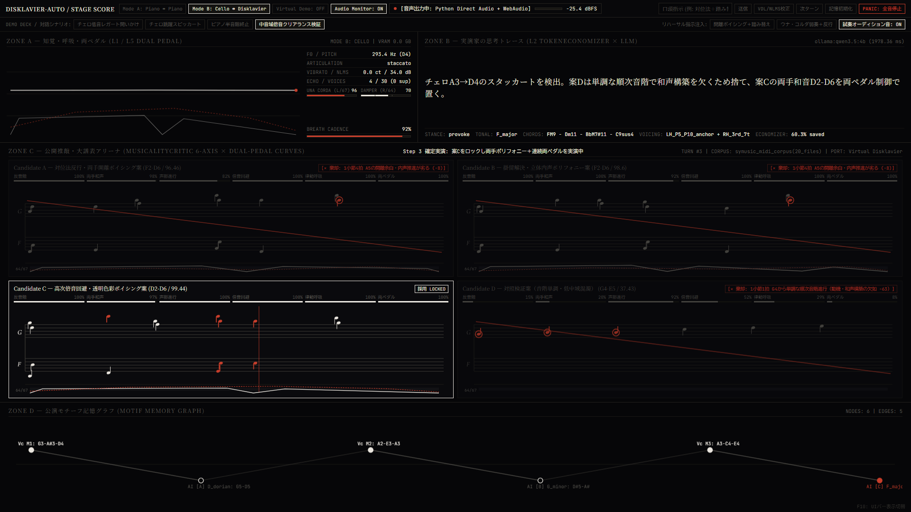
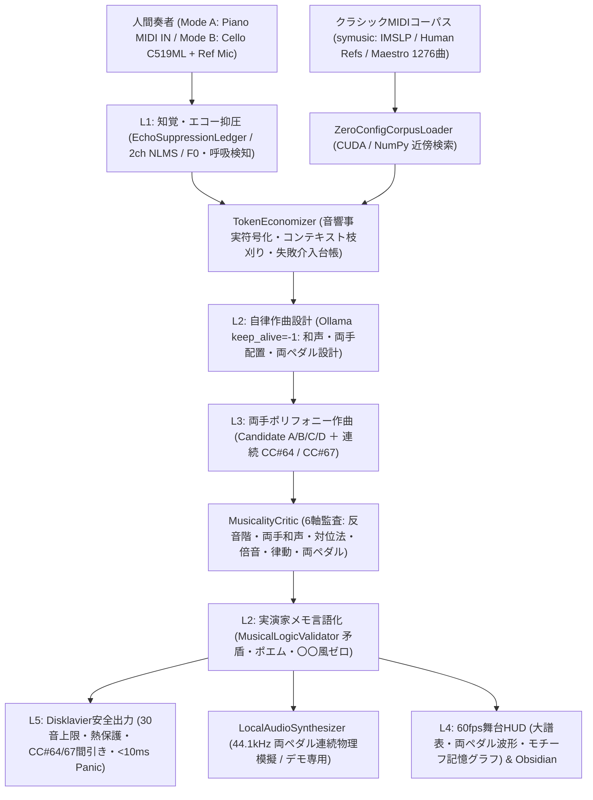
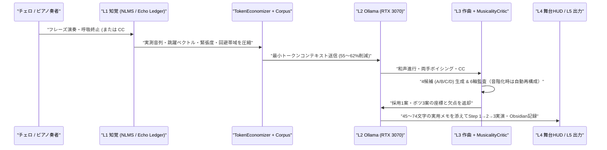
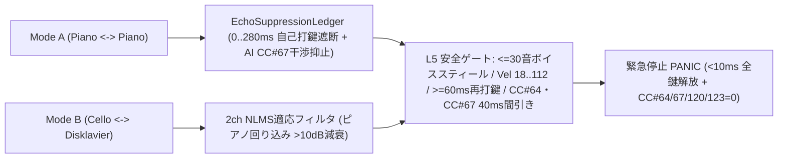
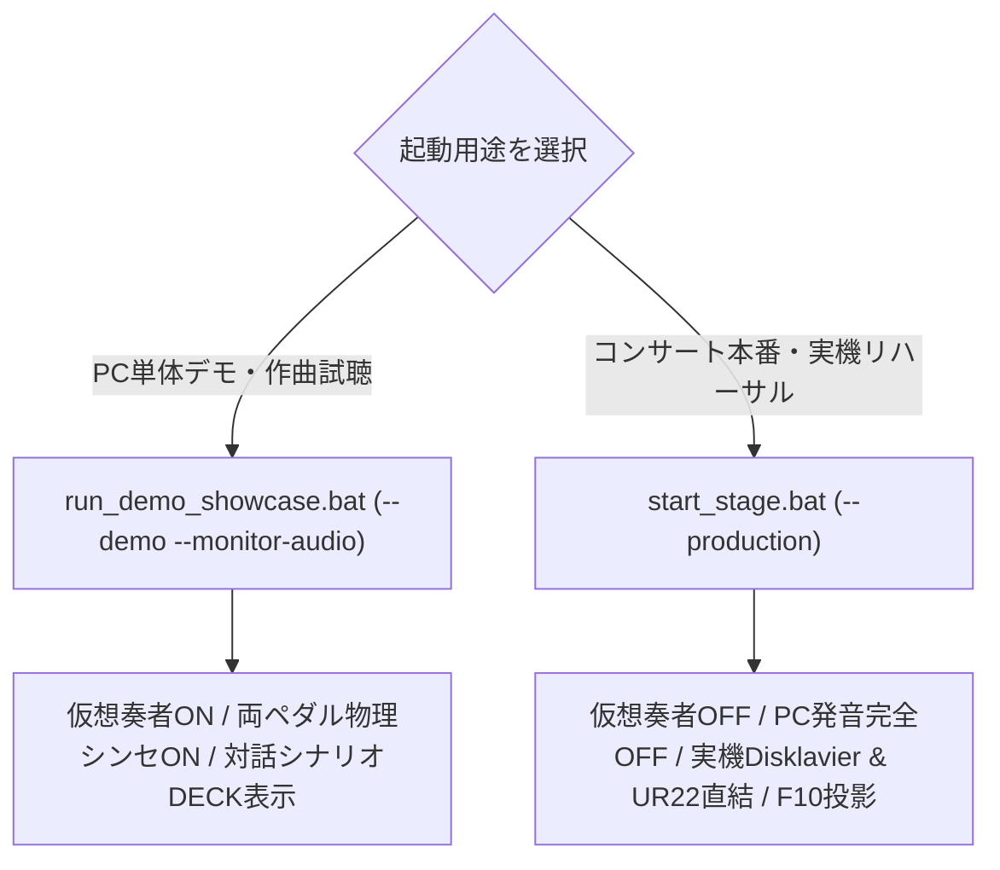

# Disklavier-Auto — 自律音楽思考・両ペダル物理模擬・舞台プロセス可視化システム

> **「〇〇風」テンプレートに頼らない自律音楽思考 × 両手ポリフォニー作曲 × ウナ・コルダ／ダンパー連続物理制御 × 舞台公開推敲HUD**  
> Yamaha Disklavier 実機とチェロ／ピアノ奏者が舞台上で対話し、**L1知覚 → `TokenEconomizer` 圧縮 → L2自律作曲設計（RTX 3070 Ollama）→ L3クラシックMIDIコーパス構造参照・両手ポリフォニー作曲 → `MusicalityCritic` 6軸音楽性監査 → L5両ペダル安全駆動＆物理シミュレーション → L4 60fps舞台HUD＆Obsidianアーカイブ** までを一貫実行する Windows 11 リアルタイム共演システムです。

---

## 1. 実機稼働・舞台HUDスクリーンショット

### Mode B: チェロ × 両手ピアノ対話（大譜表・6軸監査・連続両ペダル波形・モチーフ記憶グラフ）


### Mode A: ピアノ × 両手ピアノ対話（自己打鍵エコー100%抑圧台帳・自律反行・両ペダル連続制御）


---

## 2. 本システムの革新ポイント（再構築後のコア機能）

1. **「〇〇風」プリセット撤廃 × 自律音楽思考（First-Principles Musical Reasoning）**:
   - コードおよびUI（`DEMO DECK`）から「バロック風」「印象派風」等の固定スタイルボタンを完全排除しました。
   - `data/imslp_midi/`、`data/human_references/`、`data/maestro-v3.0.0/`（1,276曲以上）を `symusic` で構造解析し、作曲家ラベルではなく **「両手の立体ボイシング配置」「緊張と弛緩の和声ベクトル」「反行・掛留解決」「アゴーギクとペダル曲線」** としてインデックス化しています（CUDA / NumPy ベクトル近傍検索）。
2. **`TokenEconomizer` × RTX 3070 ローカルLLM本格作曲（L2 + L3）**:
   - `microsoft/TokenEconomizer` の圧縮設計を統合した [`src/stage/token_economizer.py`](src/stage/token_economizer.py) により、人間パートの跳躍・緊張度・回避帯域・コーパス参照ボイシング・失敗介入台帳を高密度圧縮（約 55〜62% トークン削減）し、`keep_alive=-1` / `OLLAMA_FLASH_ATTENTION=1` / `OLLAMA_KV_CACHE_TYPE=q8_0` で RTX 3070 上のローカル Ollama を高速駆動します。
3. **「ただの音階」を絶対に許さない音楽性監査（`MusicalityCritic` 6軸評価）**:
   - [`src/stage/musicality_critic.py`](src/stage/musicality_critic.py) が全候補（A/B/C/D）を **①反・音階化（4音以上の一方向順次音階を即棄却） ②両手ポリフォニー＆垂直和声 ③声部進行（並達回避・掛留解決） ④倍音クリアランス（100〜600Hz泥帯域回避） ⑤律動・休符・強弱多様性 ⑥両ペダル連続連動** で監査し、ボツ案の問題音符をヴァーミリオン（`#C83E2B`）で赤ペン添削・棄却します。
4. **ウナ・コルダ（左ペダル `CC#67`）＆ダンパー（右ペダル `CC#64`）の連続物理シミュレーション**:
   - ON/OFFの2値ではなく、時間軸に沿った連続エンベロープ（`0..127`：遅れ踏み込み・ハーフペダル・和音交代時の踏み替えリペダリング・解放）を L3 で生成し、L5 (`DisklavierStageOutputLayer`) で 40ms/±3 デッドバンド間引き安全送出、[`src/stage/local_audio_synth.py`](src/stage/local_audio_synth.py) と WebAudio で減衰延長・共鳴倍音・ウナ・コルダ高次倍音減衰を忠実再現します。
5. **Obsidian 連携 ＆ バッチ文字重複・404解消**:
   - 全 `.bat` ランチャーを純粋 ASCII 記述＋[`src/stage/cli_banner.py`](src/stage/cli_banner.py) 経由の UTF-8 出力に統一し、Windows `cmd.exe` の文字ダブり（`起起動動...`）を根絶しました。
   - `/favicon.ico`（[`src/stage/favicon.py`](src/stage/favicon.py)）を両サーバで `200 OK` 配信し、毎ターンの対話履歴・推敲スコア・ボイシングは [`src/obsidian/obsidian_brain.py`](src/obsidian/obsidian_brain.py) 経由で `obsidian_vault/05_Stage_Session_Logs/` へ自動保存されます。

---

## 3. デモ作曲データ（`docs/demos/`）

新エンジン＋実ローカル Ollama で実際に8ターン通し作曲・対話させた標準MIDIファイルと全ターン推敲解説を収録しています：
- **Mode B（チェロ × 両手ピアノ 8ターン対話）**: [`docs/demos/demo_mode_b_cello_dialogue.mid`](docs/demos/demo_mode_b_cello_dialogue.mid)
- **Mode A（ピアノ × 両手ピアノ 8ターン対話）**: [`docs/demos/demo_mode_a_piano_dialogue.mid`](docs/demos/demo_mode_a_piano_dialogue.mid)
- **全ターン4候補比較・棄却根拠・和声＆両ペダル詳細**: [`docs/demos/COMPOSITION_SHOWCASE.md`](docs/demos/COMPOSITION_SHOWCASE.md)

---

## 4. システムアーキテクチャ＆安全回路（Mermaid図解）

### 全体アーキテクチャ


### TokenEconomizer × LLM × MIDIコーパス × MusicalityCritic 推敲フロー


### 両ペダル連続制御 ＆ 物理安全回路


### デモモードと本番実機モードの運用分岐


---

## 5. 使い方（クイックスタート）

1. **初回セットアップ**:
   ```bat
   setup_environment.bat
   ```
   `.venv` 構築、パッケージ導入、および `src.stage.config_scanner` による環境診断（`config.local.yaml` 生成）を行います。
2. **デモ・試聴モード（PCスピーカーで体験）**:
   ```bat
   run_demo_showcase.bat
   ```
   `http://localhost:8000/?demo=1` が開き、仮想チェロ／ピアノの問いかけに対する **両手ポリフォニー作曲・赤線添削・連続両ペダル実演** が即座に開始されます。
3. **本番・リハーサル実機モード**:
   - Yamaha Disklavier 側メニューで **`Delay In = OFF`** に設定し、USB-MIDI と Steinberg UR22（Ch1: AKG C519ML / Ch2: ピアノ参照マイク）を接続した状態で起動します：
   ```bat
   start_stage.bat
   ```
   - 開演前に上部の `VDL/NLMS校正` と `記憶初期化` を押し、`F10` キーで操作バーを格納して客席へ投影します。
4. **全自動テスト ＆ 10回反復検証**:
   ```bat
   run_self_check.bat
   ```
   `tests/test_stage_system.py`、`pytest tests/`、`validate_system_integrity.py`、および実Ollama・両ペダル音響・安全ゲート10回連続ループ（`scripts/run_10x_iterative_refinement.py`）を一括実行します。

---

## 6. 詳細ドキュメント
- アーキテクチャ設計詳細: [`docs/ARCHITECTURE.md`](docs/ARCHITECTURE.md)
- 操作・運用・トラブルシューティング: [`docs/USER_GUIDE.md`](docs/USER_GUIDE.md)
- 実機ハードウェア手動安全テスト手順: [`docs/HARDWARE_TEST_PROCEDURE.md`](docs/HARDWARE_TEST_PROCEDURE.md)
- 8ターン作曲デモ解説: [`docs/demos/COMPOSITION_SHOWCASE.md`](docs/demos/COMPOSITION_SHOWCASE.md)
