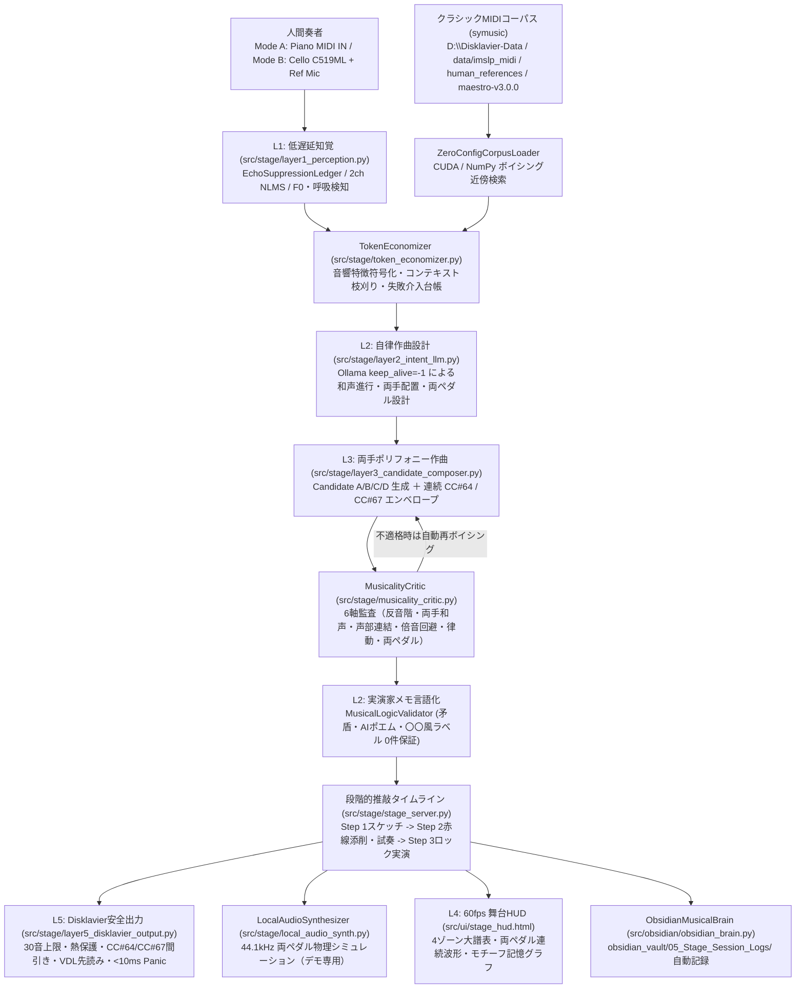
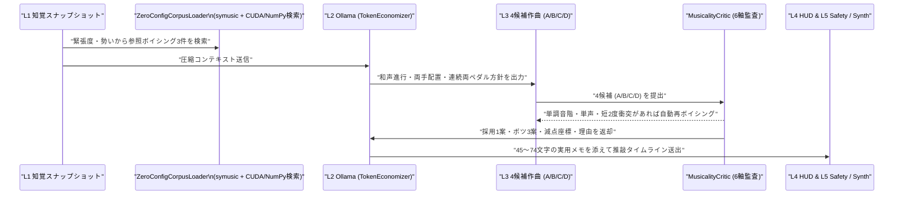
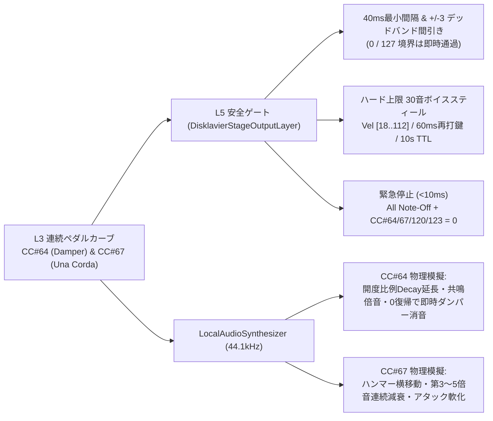

# Disklavier-Auto システムアーキテクチャ設計書 (`ARCHITECTURE.md`)

> **対象システム**: 自律音楽思考エンジン・両ペダル連続物理シミュレーション・音楽性監査・舞台プロセス可視化システム  
> **動作環境**: Windows 11 / NVIDIA GeForce RTX 3070 (8GB VRAM) / Python 3.12 / Ollama (`qwen3.5:4b` 等)

---

## 1. 全体パイプラインと5レイヤー構成

---

## 2. 各サブシステムの詳細責務

### 2.1 Layer 1: 知覚とエコー抑圧 (`src/stage/layer1_perception.py`)
- **Mode A (`EchoSuppressionLedger`)**: AIが送出した `(pitch, sent_ts)` を台帳記録し、物理打鍵帰還ウィンドウ `[0ms, 280ms]` 内に返ってきた自己打鍵ループバックを 100% 遮断し、人間の打鍵のみを通過させます。
- **Mode A (`TurnTakingDetector`)**: 人間の IOI リタルダンド、ダンパー解放、`CC#67` ウナ・コルダ合図からフレーズ終止を検知します。AI 自身が `CC#67` を駆動した直後（`0.35s` 以内）は人間の合図として誤認識しないよう `notify_ai_cc67()` で干渉を遮断します。
- **Mode B (`NLMSEchoCanceller` + `CelloAcousticPerception`)**: 16タップ2chブロック正規化LMS適応フィルタ（`mu=0.98`）でチェロマイク（Ch1）へのピアノ回り込み（Ch2参照）を除去し、F0・ビブラート・重音・アタック傾きによる `staccato` / `legato` 判別を行います。

### 2.2 TokenEconomizer (`src/stage/token_economizer.py`)
`microsoft/TokenEconomizer` の設計思想に基づき、ローカルLLMへのプロンプト情報を高密度化します：
1. **Micro-Skills & Acoustic Fact Injection**: 人間のフレーズ跳躍ベクトル（`IV=+3,+4,-2`）、和声緊張度（`T`）、リズム勢い（`M`）、濁り回避帯域（`AVOID=C3..G4`）を記号列へ圧縮。
2. **Corpus Voicing & Schema Pruning**: コーパス参照ボイシングの冗長なJSONキー・説明文を削除し、トークン削減率（`compression_ratio_pct`）を計測。
3. **Failure-Loop Intervention Ledger**: 直近の `MusicalityCritic` 棄却理由や `MusicalLogicValidator` 違反履歴を保持し、同じ失敗を防ぐ制約トークンを自動注入します。

### 2.3 L2 自律音楽思考 & 言語検閲 (`src/stage/layer2_intent_llm.py`)
- **「〇〇風」テンプレートの全面禁止**: `BANNED_PHRASES` と正規表現により、`バロック風`・`印象派風`・`ドビュッシー風` 等の模倣ラベル、音楽理論的矛盾（`長三度の空虚五度` 等）、AIポエム表現（`緊張を高める`・`余白を残して`・`共鳴` 等）をプログラムで100%拒否します。
- **RTX 3070 最適化**: Ollama 呼び出し時に `keep_alive=-1`（VRAM常駐ロック）と `think=False` を指定し、`.bat` 側で `OLLAMA_FLASH_ATTENTION=1` と `OLLAMA_KV_CACHE_TYPE=q8_0` を有効化しています。
- **自律設計スキーマ (`LLMPolicyDesignSchema`)**: 調性・和声進行・3〜5声の立体ボイシング配置（`voicing_structure`）・右手コンター（`rh_contour`）・左手運動（`lh_motion`）・連続 `CC#64`/`CC#67` 計画値をLLM自身が設計します。

### 2.4 L3 両手ポリフォニー作曲 & MusicalityCritic (`layer3_candidate_composer.py` / `musicality_critic.py`)

`MusicalityCritic` は全候補を以下の6軸（100点満点）で検査します：

| 評価軸 | 配点 | 主な検査・減点対象 |
|---|---:|---|
| 1. 反・音階化 (`anti_scale`) | 20点 | 4音以上の単調一方向順次音階進行、機械的アルペジオ反復を即棄却 |
| 2. 両手ポリフォニー＆垂直和声 (`polyphony_harmony`) | 20点 | 単音（モノフォニー）出力を禁止。LHバス/内声とRH対旋律/和音の同時和声構成を検証 |
| 3. 対位法・声部連結 (`voice_leading`) | 18点 | 並達5度・8度、同音反復停滞を減点し、反行・斜行・掛留解決を評価 |
| 4. 倍音クリアランス (`spectral_clearance`) | 18点 | CUDA/NumPy行列演算でチェロ/人間基音（100〜600Hz帯）との短2度・密集混濁を検出 |
| 5. 律動・休符・強弱多様性 (`rhythmic_diversity`) | 12点 | 均一ベタ打ちを禁止。音価対比、呼吸休符、ダイナミクス曲線を検証 |
| 6. 両ペダル連続連動 (`dual_pedal`) | 12点 | `CC#64`（遅れ踏み込み・ハーフペダル・踏み替え・解放）と `CC#67` の連続カーブを検証 |

### 2.5 両ペダル連続物理シミュレーション & L5 安全出力

