# Disklavier-Auto システムアーキテクチャ設計書 (`ARCHITECTURE.md`)

> **対象システム**: 古典和声リアライザー × 100曲4幕共同作曲ライブラリ × `/studio` & `/stage` 2画面GUI × GitHub Pages 公開デモ  
> **動作環境**: Windows 11 / NVIDIA GeForce RTX 3070 (8GB VRAM) / Python 3.12 / PyTorch CUDA 12.4 / Ollama (`qwen3.5:4b`)

---

## 1. 全体パイプラインと2画面・公開デモ構成

```mermaid
flowchart TD
    Human["人間奏者 (Mode A: Piano MIDI IN / Mode B: Cello C519ML + Ref Mic)"] --> L1["L1: 低遅延知覚 (layer1_perception.py)\nEchoSuppressionLedger / 2ch NLMS / F0・呼吸検知"]
    L1 --> Arch["CoCompositionArchitect (co_composition_architect.py)\nThematicDNA 種子核 / 4幕構成 / 公開推敲Retake"]
    Corpus["data/ クラシックMIDI資産 (1,295曲)"] --> Train["RTX 3070 学習 (train_phrase_transformer.py)\nclassical_phrase_model.pt"]
    Train --> Model["CorpusPhraseModelManager (corpus_phrase_model.py)"]
    Arch --> Econ["TokenEconomizer (token_economizer.py)\n音響事実＋4幕構成圧縮・失敗介入台帳"]
    Econ --> L2P["L2: 自律作曲設計 (layer2_intent_llm.py)\nOllama qwen3.5:4b (keep_alive=-1, FlashAttn, Q8 KV)"]
    Model --> Realizer["HarmonicBeautyRealizer (harmonic_beauty_realizer.py)\n強拍コード着地 / 跳躍回復 / 衝突回避 / CC#64境界踏替"]
    L2P --> Realizer
    Realizer --> Auditor["BeautyHarmonyAuditor & MusicalityCritic\n協和率>=90 / 平均同時発音>=2.5 / 単音率<10%"]
    Auditor --> L5["L5: Disklavier安全出力 (layer5_disklavier_output.py)\n30音上限 / 熱保護 / CC#64・CC#67間引き / <10ms Panic"]
    Auditor --> Synth["LocalAudioSynthesizer (local_audio_synth.py)\n10倍音ピアノ + チェロ共鳴 + 1.6s RT60ホール残響 -> 128kbps MP3"]
    Auditor --> StudioUI["/studio (制作・試聴スタジオ)\n100曲ブラウザ・5chミキサー・和声X線・大譜表・MIDI DL"]
    Auditor --> StageUI["/stage (本番舞台HUD)\n4ゾーン構成・F10操作バー格納・33fps WebSocket"]
    StudioUI -.->|"同一コードベース静的ビルド"| Pages["web-demo/ (GitHub Pages 自動デプロイ)"]
```

---

## 2. 主要モジュールの責務

### 2.1 古典和声・対位法リアライザー ＆ 美しさ監査器 (`src/stage/harmonic_beauty_realizer.py`)
単音化や無根拠な不協和音を構造的に根絶するため、LLM の設計を物理的・和声的制約の下で実現します：
1. **18調性・機能和声パーサー (`parse_chord_symbol`)**:
   - スラッシュ転回形（`Dm/A`, `Fmaj7/A`, `V7/lead`）や借用和音・サブドミナントマイナー・`7sus4`・`9th`・`13th` を解析し、ローマ数字機能和声（`i9`, `iv6`, `V7sus4` 等）と強拍構成音 `core_pcs` を算出します。
2. **多声古典和声リアライズ (`HarmonicBeautyRealizer`)**:
   - **単音禁止**: 左手5種の伴奏テクスチャ（`open_arpeggio_10th`, `broken_chord_barcarolle`, `chorale_voicing`, `countermelody_tenor`, `alberti_lyrical`）＋右手歌唱旋律＋内声3度/6度＋チェロ/対話パートを重ね、休符以外の単音率 `< 10%`・平均同時発音 `>= 2.5`（実測平均約 5.0 音）を保証します。
   - **強拍厳密着地 ＆ 跳躍回復法則**: 1拍目・3拍目はコード構成音へ着地（掛留音は直後の拍で2度順次下行解決）、5半音以上の跳躍後は逆方向 1〜3 半音の順次進行で回復します。
   - **50ms スライス衝突自動回避 (`resolve_vertical_clashes`)**: 正当な V7 トライトーンや解決付き掛留音以外の短2度・長7度・増4度・低域混濁を検出し、内声・伴奏を最も近い協和コード構成音へ再配置します。
   - **和音境界シンクロ両ペダル (`build_chord_synced_pedals`)**: すべてのコード切り替えの 32ms 前に `CC#64=0` で踏み替え、55ms 後に再踏み込みを行うため残響の濁りが発生しません。`CC#67`（ウナ・コルダ）は第1幕・第4幕の回想で連続的に踏み込みます。
3. **5軸美しさ監査器 (`BeautyHarmonyAuditor`)**:
   - 協和率（`>= 90`、無根拠不協和ペア `<= 2.5%`）、多声ポリフォニー（`>= 2.5` 音、単音率 `< 10%`）、旋律歌唱性（`>= 82`）、機能和声着地率（`>= 85%`）、ペダル境界踏み替え率（`>= 85%`）、および `LocalPreflightChecker` 合格を全曲で検証します。

### 2.2 100曲バッチ作曲 ＆ GitHub Pages デモパイプライン
- **`scripts/compose_100_pieces.py`**: Ollama (`qwen3.5:4b`, `keep_alive=-1`, `OLLAMA_FLASH_ATTENTION=1`, `OLLAMA_KV_CACHE_TYPE=q8_0`) ＋ `TokenEconomizer` により Mode B（チェロ×ピアノ）50曲 ＋ Mode A（ピアノ×ピアノ）50曲の計100曲（`web-demo/data/pieces/piece_001.json..piece_100.json`, `catalog_100.json`）を作曲・自動厳選し、上位代表10曲（Mode B 5曲＋Mode A 5曲）を `LocalAudioSynthesizer` で 128kbps ステレオ MP3 + SMF MIDI へ書き出します。
- **`.github/workflows/deploy-pages.yml`**: `main` へのプッシュ時に軽量ユニットテスト、`scripts/verify_catalog_and_demo.py`、および静的バンドル整合性を検証し、`web-demo/` を GitHub Pages へ自動デプロイします。

### 2.3 2画面GUI (`/studio` & `/stage`) と Windows コンソールUTF-8安全化
- **`/studio` (`src/ui/studio.html` + `web-demo/app.js`, `style.css`)**: 100曲ブラウザ、5パート聴き比べミキサー（`RH` / `LH` / `Cello` / `CC#64` / `CC#67`）、和声 X 線モニター、60fps 大譜表＆ピアノロール、公開推敲リプレイ、ブラウザ内純 JS SMF MIDI 生成ダウンロード、およびライブ舞台対話操作を統合。
- **`/stage` (`src/ui/stage_hud.html`)**: 4ゾーン本番プロジェクション画面。`F10` で操作バーを格納し、指数バックオフ WebSocket 再接続を備えます。
- **Windows コンソール文字重複バグ対策 (`src/stage/cli_banner.py`)**: 全 `.bat` から `chcp 65001` と `PYTHONIOENCODING=utf-8` を撤廃し、Win32 API `WriteConsoleW` 直接出力＋全行表示幅 `<= 72` 桁へ統一して文字重複（`起起動動...`）を根絶しました。
