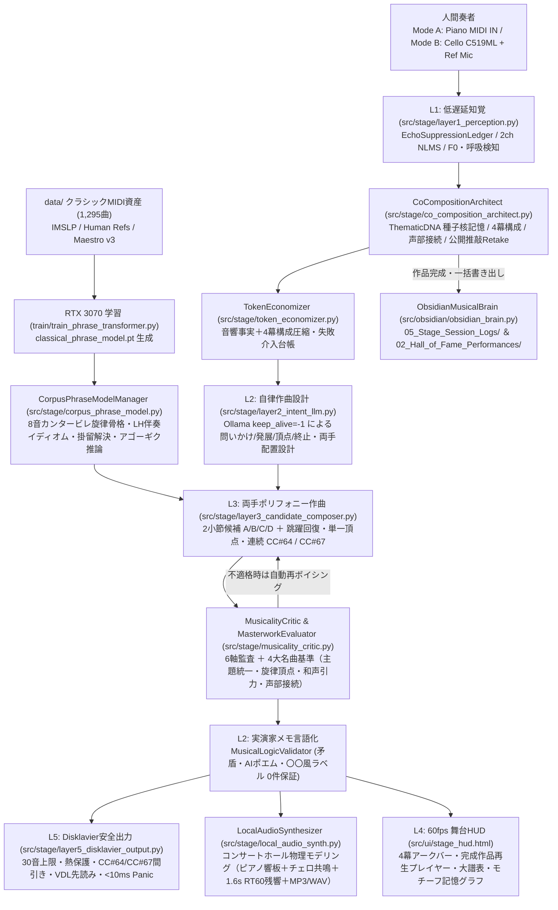
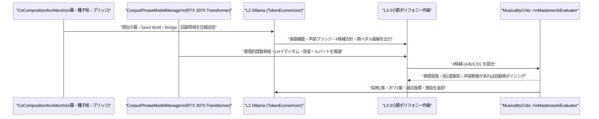
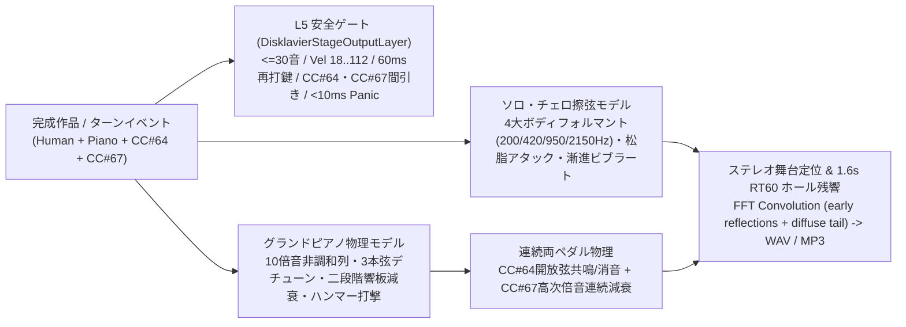

# Disklavier-Auto システムアーキテクチャ設計書 (`ARCHITECTURE.md`)

> **対象システム**: 4幕共同作曲アーキテクチャ × RTX 3070 MIDIコーパス学習 × コンサートホール音響シンセ × 舞台プロセス可視化システム  
> **動作環境**: Windows 11 / NVIDIA GeForce RTX 3070 (8GB VRAM) / Python 3.12 / PyTorch CUDA 12.4 / Ollama (`qwen3.5:4b`)

---

## 1. 全体パイプラインと5レイヤー構成

---

## 2. 各サブシステムの詳細責務

### 2.1 Layer 1: 知覚とエコー抑圧 (`src/stage/layer1_perception.py`)
- **Mode A (`EchoSuppressionLedger`)**: AIが送出した `(pitch, sent_ts)` を台帳記録し、物理打鍵帰還ウィンドウ `[0ms, 280ms]` 内に返ってきた自己打鍵ループバックを 100% 遮断し、人間の打鍵のみを通過させます。
- **Mode A (`TurnTakingDetector`)**: 人間の IOI リタルダンド、ダンパー解放、`CC#67` ウナ・コルダ合図からフレーズ終止を検知します。AI 自身が `CC#67` を駆動した直後（`0.35s` 以内）は人間の合図として誤認識しないよう `notify_ai_cc67()` で干渉を遮断します。
- **Mode B (`NLMSEchoCanceller` + `CelloAcousticPerception`)**: 16タップ2chブロック正規化LMS適応フィルタ（`mu=0.98`）でチェロマイク（Ch1）へのピアノ回り込み（Ch2参照）を除去し、F0・ビブラート・重音・アタック傾きによる `staccato` / `legato` 判別を行います。

### 2.2 4幕大局構成エンジン (`src/stage/co_composition_architect.py`)
「1ターンごとに断片を鳴らす」状態を根絶し、1つの楽曲作品（50〜95秒）として構成を統括します：
1. **第1幕（Turn 1–2 / `act1_questioning`）**: 第1ターンで人間の動機を `ThematicDNA`（音程比・リズム核・主調）として記憶し、AIは反行・模倣を織り交ぜつつ **半終止（V / sus4 / 9th）で開放して問いかけ返す**。
2. **第2幕（Turn 3–5 / `act2_development`）**: 直前フレーズの終止音から `voice_leading_bridge_pitch` で声部を滑らかに接続し、ゼクエンツ（段階的上行模進）と近親調転調（例：`D_dorian -> F_major -> G_minor -> A_minor`）で発展させる。
3. **第3幕（Turn 6–7 / `act3_climax`）**: バス保続音（ペダルポイント）・内声対旋律・高域和音による3〜4声ポリフォニーへ統合し、作品全体の単一最高音（`Apex Pitch`）に到達する（通し合成時は人間とピアノが同時アンサンブルで重なり合う）。
4. **第4幕（Turn 8+ / `act4_recapitulation_coda`）**: ウナ・コルダ（`CC#67`）とハーフペダル（`CC#64`）を用いて第1幕の `Seed Motif` を静謐に回想し、完全終止（`V7 -> I add9`）で作品を閉じる。
5. **公開リハーサル（Retake）＆ 1曲統合（Synthesize Complete Work）**:
   - `/api/stage/retake`: 人間の口頭指示（例「まだ解決せず問いかけのままにして」「左手の内声を増やして」）を受け、直前ターンのAIフレーズをその場で書き直して差分を記録します。
   - `/api/stage/synthesize_work`: 全ターンの対話とコーダを連続楽曲へ統合し、LLMが作品タイトルを命名した上で、44.1kHz ステレオ `.wav` / `.mp3` / `.mid` / `.musicxml` / Obsidian ノートを一括出力します。

### 2.3 RTX 3070 クラシックMIDIコーパス実学習 (`train/train_phrase_transformer.py` & `src/stage/corpus_phrase_model.py`)
`data/imslp_midi/`, `data/human_references/`, `data/maestro-v3.0.0/` のクラシックMIDIから `symusic` で2小節フレーズ窓を抽出し、**`ClassicalPhraseTransformerNet`**（2層 TransformerEncoder, `d_model=96, nhead=4`）を RTX 3070 CUDA 上で学習して `data/models/classical_phrase_model.pt` を生成します：
- **跳躍後の順次逆行回復（Post-Leap Gap-Fill Law）**: 5半音以上の跳躍後に逆方向へ1〜3半音順次回復する歌唱的旋律骨格を推論。
- **息づく左手伴奏イディオム（4クラス）**: `arpeggio_root_5th_10th`（根音→5度→10度開離アルペジオ）、`pedal_point_inner_voice`（深部バス保続音＋テノール対旋律）、`syncopated_offbeat_harmony`（裏拍シンコペーション和音）、`una_corda_choral_recall`（柔らかなコラール回想）。
- **掛留解決（`sus4_3`, `sus9_8`, `sus7_6`）とアゴーギク（ルバート伸縮・ベロシティ曲線）**。

### 2.4 TokenEconomizer × L2 LLM × L3 作曲 & `MasterworkEvaluator`

`MusicalityCritic` は従来の6軸（`anti_scale` 20点、`polyphony_harmony` 20点、`voice_leading` 18点、`spectral_clearance` 18点、`rhythmic_diversity` 12点、`dual_pedal` 12点）に加え、**`MasterworkEvaluator` の4大基準**（`thematic_unity` 主題統一、`melodic_arch` 跳躍回復と単一頂点、`harmonic_trajectory` 幕機能に合致するカデンツ引力、`inter_turn_continuity` 前ターンからの声部接続）で審査します。

### 2.5 コンサートホール物理モデリング音響 & L5 安全出力

