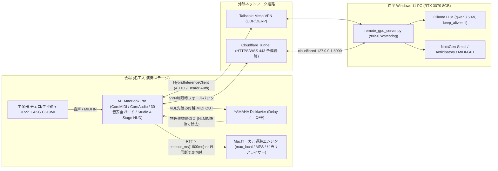
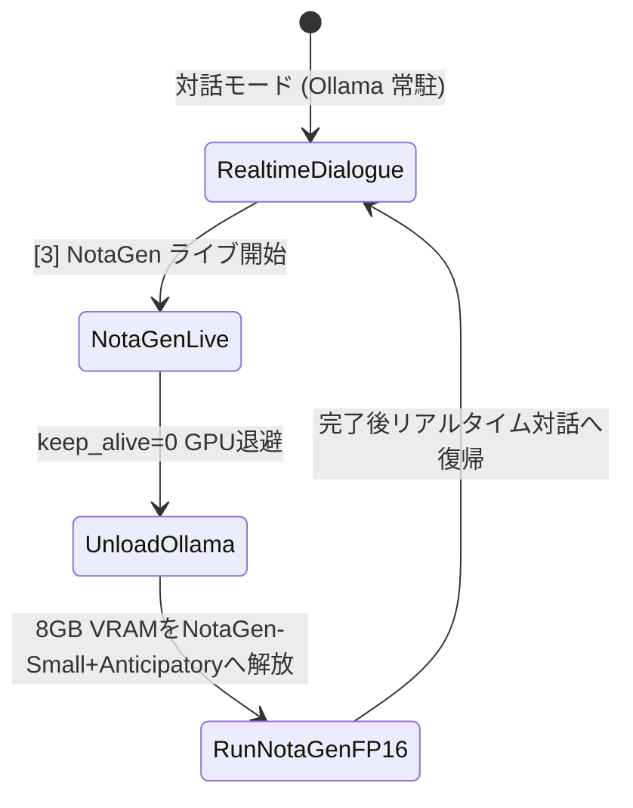

# 01. システム構成と会場Mac⇔自宅RTXハイブリッド設計

## 1. ハイブリッド分離アーキテクチャの全体像

舞台音響とDisklavier打鍵の物理的タイムラグは最小化する必要がある一方、Ollama LLMやNotaGenTransformer推論には NVIDIA RTX 3070 (8GB VRAM) の演算能力が必要です。これを両立するため、**I/Oと安全保護は会場側**、**重い推論のみを自宅RTX側**へ配置しています。

## 2. 6並列ステージパイプライン (`src/stage/parallel_pipeline.py`)

| ワーカー / 層 | 主担当コンポーネント | 役割 | 実行場所 |
| --- | --- | --- | --- |
| L1 音響・MIDI知覚 | `PerceptionWorker`, `NLMSEchoCanceller`, `EchoSuppressionLedger` | 44.1kHzブロックNLMSピアノ回り込み除去、YIN F0推定、呼吸/終止検知、Mode A自己打鍵除去 | 会場 M1 Mac |
| トークン圧縮・大局設計 | `TokenEconomizer`, `CoCompositionArchitect` | 生音声・MIDI状態からコンパクト音楽文脈を生成、4幕ドラマツルギー・連結橋音管理 | 会場 Mac / 自宅 RTX |
| L2 意図推論 LLM | `AsyncLLMIntentWorker`, `MusicalIntentEngine` | JSON構造化意図（和声機能・声部関係・両ペダル戦略・実務的演奏メモ）を推論 | 自宅 RTX (退避: Mac) |
| L3 4候補並列作曲・先行生成 | `MultipleCandidateComposer`, `SpeculativePreGenWorker` | 案A〜Dの4方向を並列生成し `HarmonicBeautyRealizer` で単音抜き/不協和音補修＆採点 | 自宅 RTX (退避: Mac) |
| L4 先行レンダラ | `AudioRenderWorker` | WebAudio/試聴用音声・楽譜スナップショット生成とブラックボックス録画補助 | 会場 M1 Mac |
| L5 Disklavier 物理出力 | `DisklavierStageOutputLayer` | 鍵盤ごとの機械着火遅延 `offset_ms(pitch, vel)` 先読み、30音ポリ上限、5ms緊急PANIC | 会場 M1 Mac |

## 3. 無停止自動フェイルオーバー状態遷移 (`HybridInferenceClient`)

1. **`AUTO`（本番推奨）**: 自宅 RTX (`remote_rtx`) へ Bearer 認証付き HTTP/HTTPS (`POST /api/v1/infer/deliberate`) を送信します。
2. **`> timeout_ms`（既定 `1800 ms`）またはソケット切断を検知した瞬間**: 例外を外へ漏らさず即座に会場 M1 Mac 側のローカル推論関数（`mac_local_failover`）を実行し、音楽の拍や応答を止めずに演奏を継続します。
3. **サーキットブレーカー & 自動復帰**: `recovery_cooldown_s` 期間中は非同期スレッドで `/api/v1/health` をバックグラウンドプローブし、回線回復後は次のターンから自動的に `remote_rtx` へ復帰します。
4. **`MAC_LOCAL_ONLY` / `REMOTE_RTX_ONLY`**: トップバーおよび `/stage` HUD のドロップダウンから1クリックで強制切替できます。

## 4. RTX 3070 8GB VRAM 動的調停 (`RTX3070VRAMManager`)

