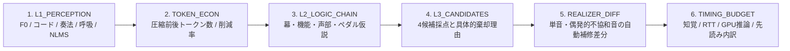

# 04. 6段階「論理思考トレース」・音楽エンジン仕様

## 1. リアルタイム6段階論理思考トレース (`src/stage/logic_trace.py`)

実機テスト中に「AIが何を聴き取り、なぜその声部とペダルを選択したのか」をブラックボックス化させず透明化するため、毎ターン以下の **6段階** で構造化データを生成します（UI内「**論理思考トレース (6段階)**」タブ、`GET /api/stage/logic_trace`、および `recordings/session_*/logic_trace.jsonl` へ保存）。

### 各段階のフィールドと解釈方法

1. **`L1_PERCEPTION`**:
   - 検出音名 (`note_name`)、F0 (`f0_hz`)、和音推定 (`detected_chord`)、奏法 (`articulation`, `vibrato_cents`)、呼吸終止ゲージ (`breath_gauge`, `turn_reason`)、NLMS 減衰量 (`nlms_erle_db`)、自己打鍵抑制数 (`echo_suppressed_count`)。
2. **`TOKEN_ECON`**:
   - 生演奏イベント列からの圧縮前トークン数 (`raw_tokens_est`)、圧縮後トークン数 (`compressed_tokens_est`)、削減率 (`compression_ratio_pct`)、および LLM へ実際に渡された要点文脈 (`compact_context_preview`)。
3. **`L2_LOGIC_CHAIN`**:
   - `CoCompositionArchitect` の4幕構成と LLM 構造化推論から立てられた仮説 (`hypothesis_ja`)、調性 (`tonal_center`)、ボイシング構造 (`voicing_structure`)、ペダル計画 (`pedal_strategy`, `damper_cc64_plan`, `una_corda_cc67_plan`)。
4. **`L3_CANDIDATES`**:
   - 並列生成された **案A〜案D** それぞれの総合スコア (`total_score_pct`)、4軸内訳（`consonance_pct` / `polyphony_pct` / `cantabile_pct` / `pedal_sync_pct`）、および不採用案の具体的棄却理由 (`rejection_reason_ja` 例: 対照検証案 / 短2度衝突 / 左手バス不足)。
5. **`REALIZER_DIFF`**:
   - `HarmonicBeautyRealizer` が補修に入る前後の音符数 (`raw_note_count` → `realized_note_count`)、単音ギャップ率 (`monophonic_gaps_before_pct` → `monophonic_gaps_after_pct`)、垂直衝突数 (`vertical_clashes_before` → `vertical_clashes_after`)、解除件数 (`dissonances_resolved`)、追加された連続ペダル CC 点数 (`pedal_events_added`)。
6. **`TIMING_BUDGET`**:
   - L1知覚時間 (`perception_ms`) / ネットワーク往復遅延 (`network_rtt_ms`) / 自宅GPU推論時間 (`gpu_infer_ms`) / VDL先読み時間 (`lookahead_ms`) / 総応答時間 (`total_response_ms`) と実行バックエンド (`remote_rtx`, `mac_local`, `mac_local_failover`)。

## 2. 美的・和声的リアライザー (`HarmonicBeautyRealizer`) と音楽法則

- **単音抜け防止と多声連結**: 左手に開離5度・アルベルティ/アルペジオ・持続バスの骨格を補完し、単なる無意味な単音列のまま Disklavier へ送出されることを防ぎます。
- **偶発的不協和音の自動回避 (`resolve_vertical_clashes` / `count_vertical_clashes`)**: 和音タイムラインおよび掛留解決ウィンドウ外での短2度・長7度等の無意図な垂直衝突を検出し、安全な和声音へ自動調整・再監査します。
- **両ペダル連動設計**: フレーズ境界や和音変化時刻と同期して右ダンパー (`CC#64`) の踏み替え谷と左ソフトペダル (`CC#67`) の音色深度を連続制御します。
- **実務的リハーサル語彙規程 (`chamber-music-diction`)**: AIの内省メモ (`monologue_ja`) やログ表現において過剰な擬人化ポエムを禁止し、実際に検出した音高・和音進行・棄却根拠のみに基づく簡潔なスコアリーディング記述を生成します。
