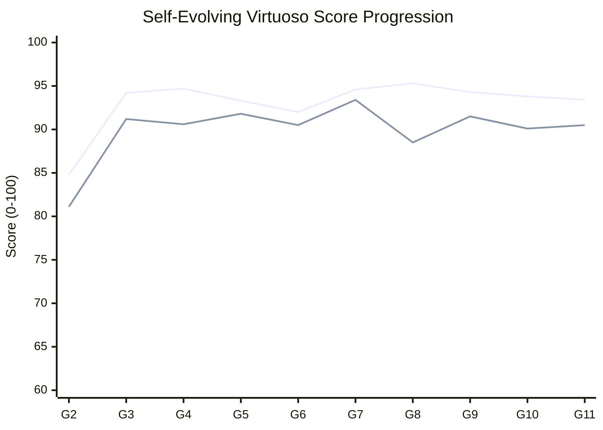
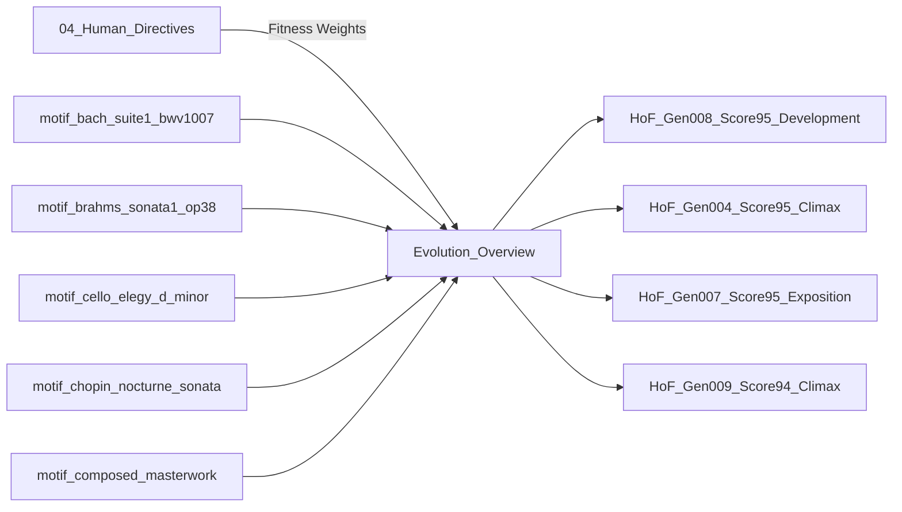

# 🎹 Autonomous Virtuoso — Evolution Overview

## システム統計 (Live System Stats)
- **現在の世代 (Current Generation)**: `Generation 11`
- **最新採用スコア (Latest Score)**: `93.4 / 100.0 pts`
- **歴代最高スコア (All-Time Peak)**: `95.3 / 100.0 pts`
- **Hall of Fame 殿堂入り名演数**: `9 performances`
- **Motif Library 登録数**: `11 motifs`

## 📈 進化スコア推移 (Evolution Trajectory)

## 🏆 歴代最高スコアランキング (Hall of Fame)
| Rank | Performance Note | Generation | Total Score |
|---|---|---|---|
| #1 | [[HoF_Gen008_Score95_Development]] | Gen 8 | **95.3 pts** |
| #2 | [[HoF_Gen004_Score95_Climax]] | Gen 4 | **94.7 pts** |
| #3 | [[HoF_Gen007_Score95_Exposition]] | Gen 7 | **94.6 pts** |
| #4 | [[HoF_Gen009_Score94_Climax]] | Gen 9 | **94.3 pts** |
| #5 | [[HoF_Gen003_Score94_Development]] | Gen 3 | **94.2 pts** |
| #6 | [[HoF_Gen010_Score94_Recapitulation]] | Gen 10 | **93.8 pts** |
| #7 | [[HoF_Gen011_Score93_Metamorphosis]] | Gen 11 | **93.4 pts** |
| #8 | [[HoF_Gen005_Score93_Recapitulation]] | Gen 5 | **93.3 pts** |
| #9 | [[HoF_Gen006_Score92_Metamorphosis]] | Gen 6 | **92.0 pts** |

## 🕸️ 音楽知識グラフ (Knowledge Graph)

## コントロール
- 人間の音楽的要望は [[04_Human_Directives]] に記述してください。
