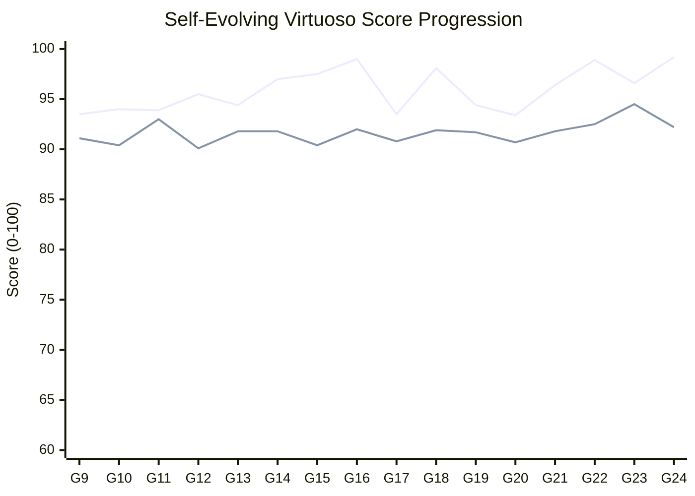
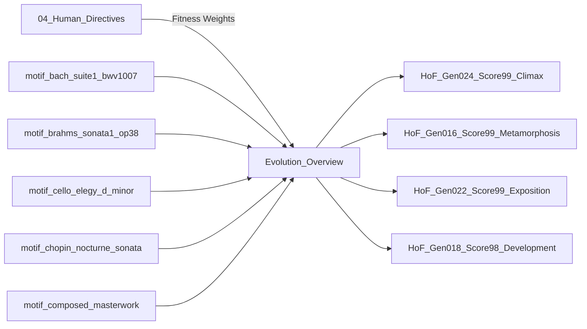

# 🎹 Autonomous Virtuoso — Evolution Overview

## システム統計 (Live System Stats)
- **現在の世代 (Current Generation)**: `Generation 24`
- **最新採用スコア (Latest Score)**: `99.2 / 100.0 pts`
- **歴代最高スコア (All-Time Peak)**: `99.2 / 100.0 pts`
- **Hall of Fame 殿堂入り名演数**: `22 performances`
- **Motif Library 登録数**: `11 motifs`

## 📈 進化スコア推移 (Evolution Trajectory)

## 🏆 歴代最高スコアランキング (Hall of Fame)
| Rank | Performance Note | Generation | Total Score |
|---|---|---|---|
| #1 | [[HoF_Gen024_Score99_Climax]] | Gen 24 | **99.2 pts** |
| #2 | [[HoF_Gen016_Score99_Metamorphosis]] | Gen 16 | **99.0 pts** |
| #3 | [[HoF_Gen022_Score99_Exposition]] | Gen 22 | **98.9 pts** |
| #4 | [[HoF_Gen018_Score98_Development]] | Gen 18 | **98.1 pts** |
| #5 | [[HoF_Gen015_Score98_Recapitulation]] | Gen 15 | **97.5 pts** |
| #6 | [[HoF_Gen023_Score97_Development]] | Gen 23 | **96.6 pts** |
| #7 | [[HoF_Gen021_Score96_Metamorphosis]] | Gen 21 | **96.4 pts** |
| #8 | [[HoF_Gen012_Score96_Exposition]] | Gen 12 | **95.5 pts** |
| #9 | [[HoF_Gen008_Score95_Development]] | Gen 8 | **95.3 pts** |
| #10 | [[HoF_Gen004_Score95_Climax]] | Gen 4 | **94.7 pts** |

## 🕸️ 音楽知識グラフ (Knowledge Graph)

## コントロール
- 人間の音楽的要望は [[04_Human_Directives]] に記述してください。
