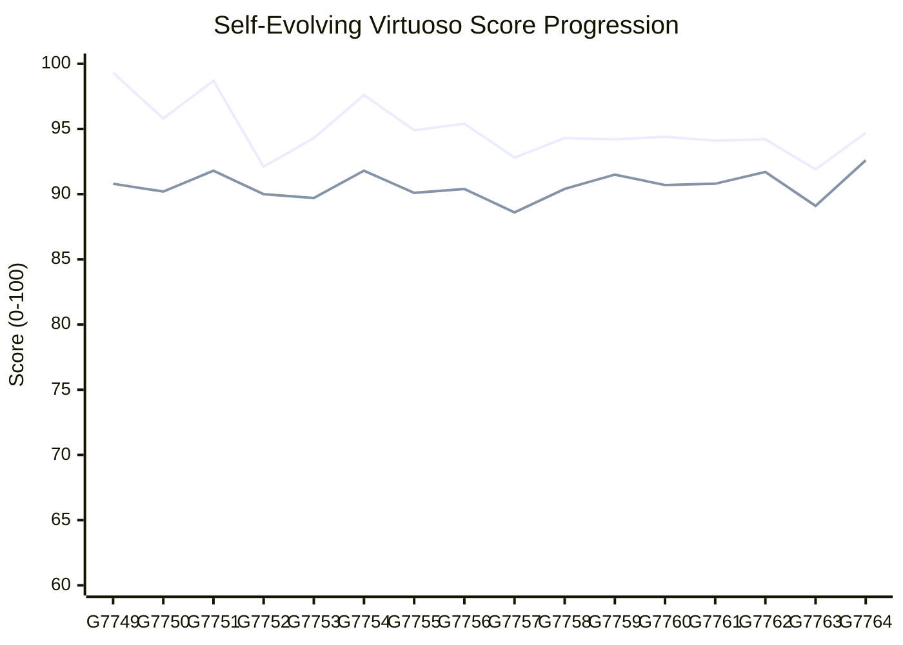
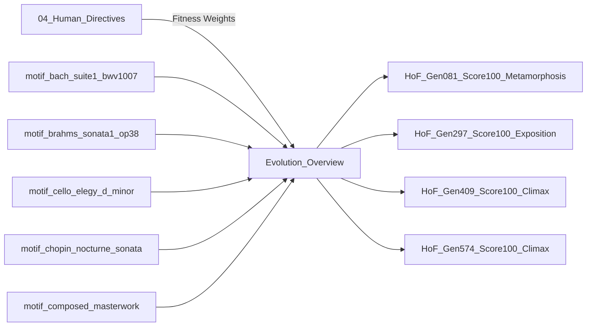

# 🎹 Autonomous Virtuoso — Evolution Overview

## システム統計 (Live System Stats)
- **現在の世代 (Current Generation)**: `Generation 7764`
- **最新採用スコア (Latest Score)**: `94.7 / 100.0 pts`
- **歴代最高スコア (All-Time Peak)**: `100.0 / 100.0 pts`
- **Hall of Fame 殿堂入り名演数**: `36 performances`
- **Motif Library 登録数**: `11 motifs`

## 📈 進化スコア推移 (Evolution Trajectory)

## 🏆 歴代最高スコアランキング (Hall of Fame)
| Rank | Performance Note | Generation | Total Score |
|---|---|---|---|
| #1 | [[HoF_Gen081_Score100_Metamorphosis]] | Gen 81 | **100.0 pts** |
| #2 | [[HoF_Gen297_Score100_Exposition]] | Gen 297 | **100.0 pts** |
| #3 | [[HoF_Gen409_Score100_Climax]] | Gen 409 | **100.0 pts** |
| #4 | [[HoF_Gen574_Score100_Climax]] | Gen 574 | **100.0 pts** |
| #5 | [[HoF_Gen793_Score100_Development]] | Gen 793 | **100.0 pts** |
| #6 | [[HoF_Gen874_Score100_Climax]] | Gen 874 | **100.0 pts** |
| #7 | [[HoF_Gen958_Score100_Development]] | Gen 958 | **100.0 pts** |
| #8 | [[HoF_Gen1204_Score100_Climax]] | Gen 1204 | **100.0 pts** |
| #9 | [[HoF_Gen1290_Score100_Recapitulation]] | Gen 1290 | **100.0 pts** |
| #10 | [[HoF_Gen1345_Score100_Recapitulation]] | Gen 1345 | **100.0 pts** |

## 🕸️ 音楽知識グラフ (Knowledge Graph)

## コントロール
- 人間の音楽的要望は [[04_Human_Directives]] に記述してください。
