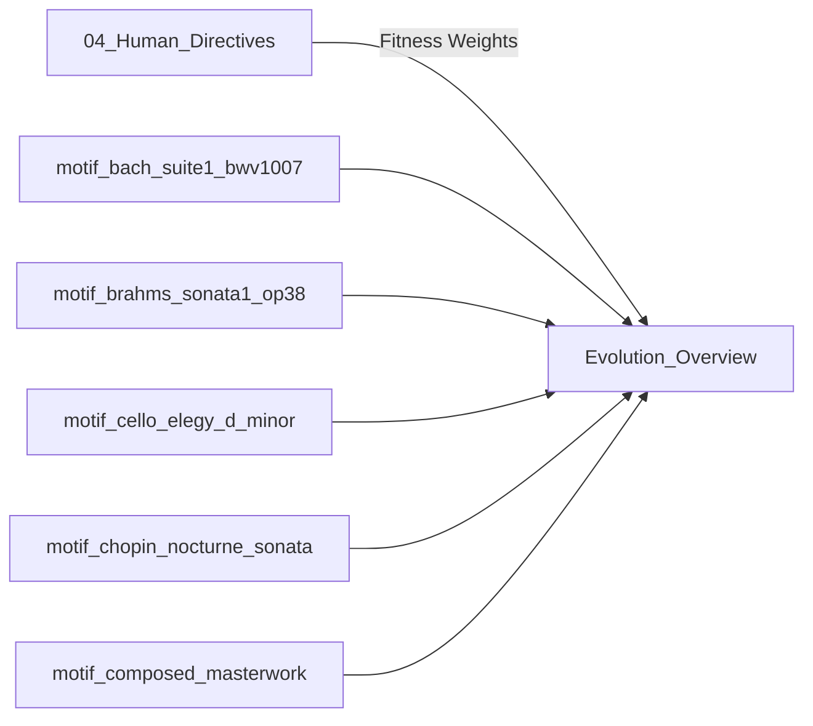

# 🎹 Autonomous Virtuoso — Evolution Overview

## システム統計 (Live System Stats)
- **現在の世代 (Current Generation)**: `Generation 1`
- **最新採用スコア (Latest Score)**: `0.0 / 100.0 pts`
- **歴代最高スコア (All-Time Peak)**: `0.0 / 100.0 pts`
- **Hall of Fame 殿堂入り名演数**: `0 performances`
- **Motif Library 登録数**: `14 motifs`

## 📈 進化スコア推移 (Evolution Trajectory)
```mermaid
xychart-beta
    title "Self-Evolving Virtuoso Score Progression"
    x-axis [G1]
    y-axis "Score (0-100)" 60 --> 100
    line [75.0]
    line [72.0]
```

## 🏆 歴代最高スコアランキング (Hall of Fame)
| Rank | Performance Note | Generation | Total Score |
|---|---|---|---|
| - | (Waiting for >= 85 pts) | - | - |

## 🕸️ 音楽知識グラフ (Knowledge Graph)


## コントロール
- 人間の音楽的要望は [[04_Human_Directives]] に記述してください。
